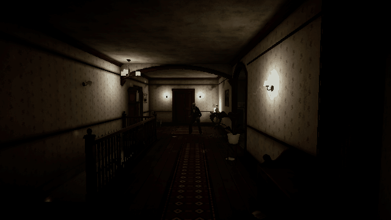
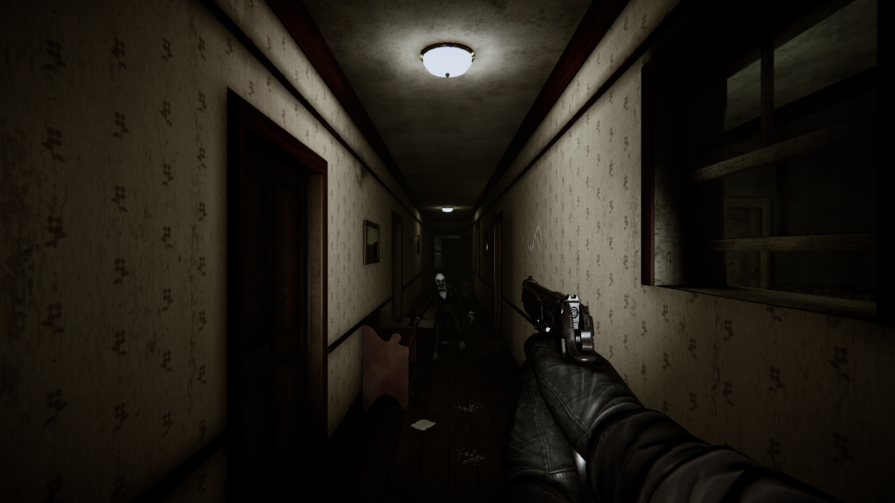
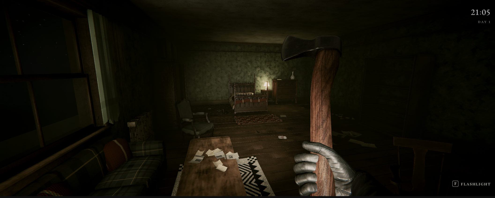
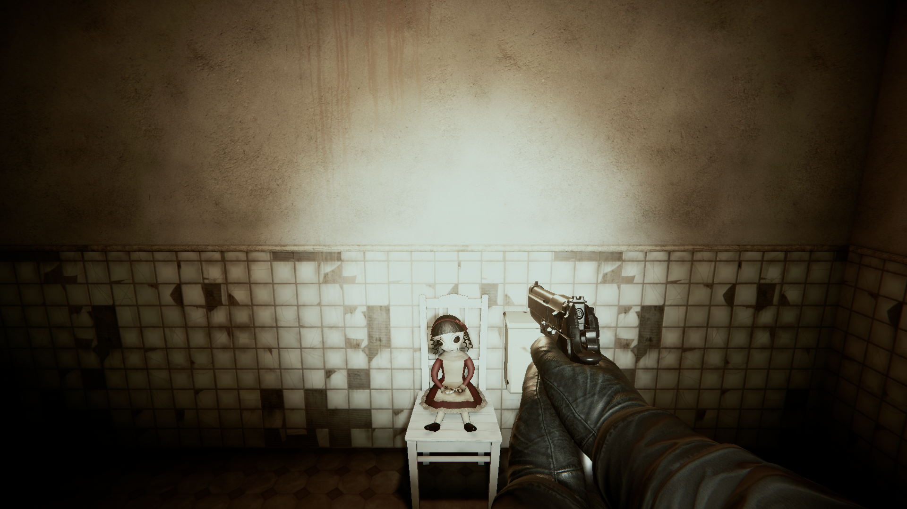
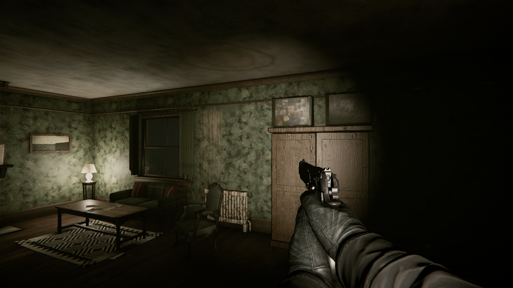
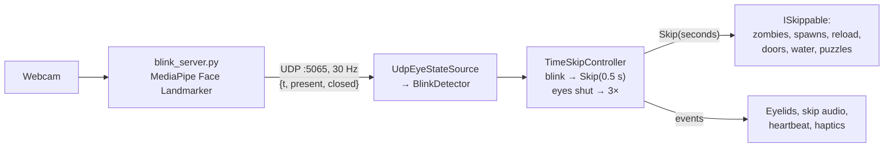

<div align="center">

# BLINK

**Every time you blink, time skips forward. Use it, but only when it's safe.**

*A webcam-controlled first-person horror game, made in 24 hours for the CSS Game Jam 2026 (University of Bristol). Theme: **TIME**.*




</div>

---

## The pitch

You wake up in a strange bed in a rotting house where time stopped in 1946. **Your webcam watches your eyes.**

- **Blink**, and the world jumps forward half a second.
- **Keep your eyes shut**, and it runs at 3× until you open them.

Everything moves forward, including what's helping you: your reload finishes, the jammed door gives, the water drains. The things hunting you move forward too. Every few seconds you're asking yourself one question: ***is it safe to close my eyes right now?***

You can't stop blinking, so you always lose a little ground. Holding your eyes shut gets work done, but you're blind while it happens.

## Screenshots

| | |
|---|---|
|  |  |
|  |  |

*All screenshots are in-engine: real-time URP lighting, a baked lightmap and post-processing.*

## How it uses TIME

Time is the controller, not just the setting. The only way to move time is with your real eyes. Looking away from the camera does nothing; only closing your eyes counts.

| Room | Rule | What happens |
|---|---|---|
| **The bedroom** (tutorial) | Eyes shut gets work done | A jammed door only gives way if you hold your eyes shut long enough, while something shambles towards you. |
| **Lily's doll** | Don't blink, don't look away | A porcelain doll holds the key you need. Walk in staring at it and back out without blinking. Every blink, it's closer. |
| **The flooded basement** | Don't blink, then blinks help | The door slams and the tap runs. Each blink makes the water lurch up. Find the crowbar, wrench off the drain cover, then blink to drain it. |
| **Throughout** | Read danger blind | With your eyes shut you hear a heartbeat and footsteps that speed up as zombies close in; a gamepad rumbles with the pulse. Open your eyes on the sound. |

## Features

- **Real blink detection**: MediaPipe face blendshapes with hysteresis, streamed to Unity at 30 Hz. No keyboard blink.
- **Two time verbs**: an instant skip on a blink, and a 3× fast-forward with your eyes held shut. Everything that matters implements `ISkippable`.
- **Skip feedback**: eyelids that close on screen in time with your own, and a camera-shutter click on every skip.
- **A wake-up opening**: the game opens on *BLINK to begin*. Your first real blink opens the eyelids and you sit up in bed.
- **Combat**: a pistol with limited ammo and reloads, an axe and improvised melee (crowbar, frying pan, pipe wrench). You have one hand, so picking something up swaps it for what you're holding.
- **A handmade bungalow**: rooms, props, lighting, decals and audio are all generated from scripts, so the whole house can be rebuilt from scratch.
- **Environmental storytelling**: notes, decaying family photos and heirlooms hint at what happened at the Hale estate.

## Controls

| Input | Action |
|---|---|
| **Blink** (webcam) | The world skips 0.5 s |
| **Eyes shut** (webcam) | The world runs at 3× until you open them |
| WASD / left stick | Move |
| Mouse / right stick | Look |
| Shift | Sprint |
| Left click / right trigger | Shoot / swing |
| R / gamepad West | Reload |
| E | Pick up / use / read |
| Hold E | Force the jammed door |
| G / d-pad down | Drop what's in your hand |
| F1 | Blink debug overlay |
| Esc | Free the cursor |

## Run it

**You need:** Unity **6000.6.8f1**, Python **3.12** (MediaPipe doesn't support 3.14 yet) and a webcam in decent light.

1. Clone the repo and open `Unity/` in Unity Hub.
2. Set up the blink sidecar once, from the repo root:
   - Windows: `powershell -ExecutionPolicy Bypass -File blink_server/setup.ps1`
   - macOS / Linux: `sh blink_server/setup.sh`
3. Open `Assets/Scenes/House_Bungalow.unity` and press **Play**. Unity starts the sidecar automatically, so you don't need a terminal.

**No webcam?** Fake blinks while playing: `python blink_server/send_test_blinks.py blink` (or `hold 2`, or `demo`).
Tuning and troubleshooting: [docs/ARCHITECTURE.md](docs/ARCHITECTURE.md#try-it).

## Tech stack

| Layer | What we used |
|---|---|
| Engine | Unity 6 (6000.6.8f1), Universal Render Pipeline 17, C# |
| Unity packages | Input System (keyboard, mouse, gamepad, haptics), AI Navigation (zombie navmesh), Animation Rigging, Unity Test Framework |
| Eye tracking | Python 3.12, [MediaPipe Face Landmarker](https://ai.google.dev/edge/mediapipe/solutions/vision/face_landmarker) (`eyeBlinkLeft` / `eyeBlinkRight` blendshapes), OpenCV |
| Game ↔ sidecar | UDP on `127.0.0.1:5065`: small JSON packets `{t, present, closed}` |
| Content pipeline | Blender Python scripts for props, the house layout, decals and lighting data (`tools/blender/`), plus Unity editor menus that rebuild and dress the scene |
| Audio | CC0 / CC-BY libraries, plus procedurally synthesised SFX in Python (`tools/audio/`): the doll's music box, the flood |
| Art | Poly Haven and ambientCG PBR textures, Sketchfab and Mixamo models, generated family photos (`Art/Story/Photos/`) |
| Tooling | [MCP for Unity](https://github.com/CoplayDev/unity-mcp) to drive the editor from Claude Code |

## How it works



- **A skip is not a physics step.** Zombies move along their navmesh path by `speed × seconds` and are warped there. Timers (reload, doors, flood level, spawns) just add the seconds, so skips are cheap and deterministic.
- **The camera, UI and audio cues run on unscaled time**, so feedback stays snappy while the world is fast-forwarding.
- More in [docs/ARCHITECTURE.md](docs/ARCHITECTURE.md).

## Repo layout

| Path | What's there |
|---|---|
| `Unity/` | The game. Code in `Assets/Scripts/` (Detection, TimeSkip, Player, Combat, Mobs, Puzzles, Effects, Audio…), tests in `Assets/Tests/` |
| `blink_server/` | The Python webcam sidecar, its setup scripts and the fake-blink tool |
| `tools/` | Content generators: Blender props and house data, procedural audio, textures |
| `docs/` | [Game plan](docs/GAME_PLAN.md), [story](docs/STORY_PLAN.md), [architecture](docs/ARCHITECTURE.md), [puzzle briefs](docs/puzzles/), [bungalow spec](docs/bungalow/SPEC.md) |

## Team

Made by **Jack Price**, **Joseph Meadowcroft** and **[diyon-k](https://github.com/diyon-k)** for the CSS Game Jam 2026, University of Bristol.

<!-- TODO: add roles, e.g. "blink tech & gameplay", "level & art", "puzzles & audio" -->

## Credits

These assets are used under licences that require attribution:

| Asset | Author | Licence | Used for |
|---|---|---|---|
| [Animated pistol](https://sketchfab.com/3d-models/animated-pistol-bd896167e7ca44f19597d3afe6a8d83f) | DJMaesen (bumstrum) | [CC BY 4.0](https://creativecommons.org/licenses/by/4.0/) | First-person arms and pistol |
| [Axe](https://sketchfab.com/3d-models/7f039a3e6834494a80a3c0a7b2bd5a4c) | bumstrum | [CC BY 4.0](https://creativecommons.org/licenses/by/4.0/) | First-person axe |
| [Fleshy Fight Sounds](https://opengameart.org/content/fleshy-fight-sounds) | Additional Sound FX by Will Leamon | [OGA-BY 3.0](https://opengameart.org/content/oga-by-30-faq) | Bullet and axe hits |
| [15 monster grunt/pain/death sounds](https://opengameart.org/content/15-monster-gruntpaindeath-sounds) | Michel Baradari ([apollo-music.de](https://apollo-music.de)) | [CC BY 3.0](https://creativecommons.org/licenses/by/3.0/) | Zombie grunts and death cries |
| [2 metal weapon clicks](https://opengameart.org/content/2-metal-weapon-clicks) | Michel Baradari ([apollo-music.de](https://apollo-music.de)) | [CC BY 3.0](https://creativecommons.org/licenses/by/3.0/) | Pistol dry-fire and mag-out clicks |
| [Horror Sound Effects Library](https://opengameart.org/content/horror-sound-effects-library) | Little Robot Sound Factory ([littlerobotsoundfactory.com](https://www.littlerobotsoundfactory.com)) | [CC BY 3.0](https://creativecommons.org/licenses/by/3.0/) | Zombie screams, kill-shot crunch |
| [Creaky light wooden door](https://opengameart.org/content/creaky-light-wooden-door) | fractilegames | [CC BY 3.0](https://creativecommons.org/licenses/by/3.0/) | Jammed door strain |
| [FPS Placeholder Sounds](https://opengameart.org/content/fps-placeholder-sounds) | Jack Menhorn | [CC BY 3.0](https://creativecommons.org/licenses/by/3.0/) | Player hurt grunts |
| [Packsmithy SFX sampler](https://opengameart.org/content/packsmithy-sfx-sampler-30-synthesised-sound-effects-ui-retro-horror-sci-fi-glitch) | Packsmithy ([packsmithy.com](https://packsmithy.com)) | [CC BY 4.0](https://creativecommons.org/licenses/by/4.0/) | Grab jump-scare stings |

Fonts: [Cormorant SC](https://github.com/CatharsisFonts/Cormorant) (Christian Thalmann) and [EB Garamond](https://github.com/octaviopardo/EBGaramond12) (Georg Duffner, Octavio Pardo), under the [SIL OFL 1.1](https://openfontlicense.org); the licence texts are in `Unity/Assets/Art/UI/Fonts/`.

Everything else is CC0 (Poly Haven, ambientCG, Kenney, OpenGameArt), royalty-free (Mixamo, Unity Asset Store), or made by us.

---

## Contributing (team notes)

- **Importing a CC-BY or OGA-BY asset?** Add it to the Credits table above. CC0 assets need no entry. No NC, SA or editorial licences. Mixamo and Asset Store raw files mustn't be redistributed, so remove them from git before making the repo public.
- One branch per feature, then a PR into `main`, using [Conventional Commits](https://www.conventionalcommits.org) (`feat(mobs): ...`).
- `House_Bungalow.unity` is **generated**. Don't hand-merge scene YAML: take `main`'s scene and re-run the builders (see [docs/ARCHITECTURE.md](docs/ARCHITECTURE.md#working-together-without-merge-pain)).
- Turn on Unity's scene/prefab merge tool once per clone (`.gitattributes` already routes Unity files to it):
  ```sh
  # Windows (adjust the version folder); on macOS it's in Unity.app/Contents/Tools/UnityYAMLMerge
  git config merge.unityyamlmerge.driver '"C:/Program Files/Unity/Hub/Editor/6000.6.8f1/Editor/Data/Tools/UnityYAMLMerge.exe" merge -p %O %B %A %A'
  git config merge.unityyamlmerge.recursive binary
  ```
