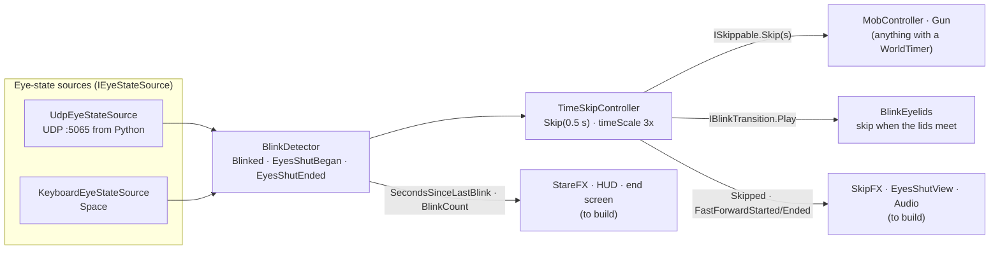

# BLINK: Architecture

How the code is split, how the pieces talk to each other, and who owns what. Read [GAME_PLAN.md](GAME_PLAN.md) for the design.

The core is already working end to end: the webcam sidecar's UDP messages (or the `Space` key) drive the blink detector, which drives time skips, which move the zombies and finish reloads. Every workstream below plugs into that core through **events and interfaces**, so people can build in parallel without editing each other's files.

## Try it

1. Open `Unity/Assets/Scenes/Sandbox.unity` and press Play.
2. Controls:

| Input | Action |
|---|---|
| WASD / left stick | Move |
| Mouse / right stick | Look |
| Left click / right trigger | Shoot / swing the axe |
| R / gamepad West | Reload |
| 1 / 2 / 3 | Hands / pistol / axe |
| Mouse wheel, gamepad LB / RB or d-pad left / right | Previous / next weapon |
| E / gamepad North | Interact (hold to force a door), with any weapon |
| **Space: tap** | Blink (world skips 0.5 s) |
| **Space: hold** | Eyes shut (world runs at 3× until released) |
| F1 | Toggle the blink debug overlay |
| Esc | Free the cursor (click to lock again) |

3. **Real webcam:** run the setup once from the repo folder. After that, pressing Play starts the webcam sidecar automatically (in the Editor on Windows and macOS; the face model downloads itself on first run).
   - Windows: `powershell -ExecutionPolicy Bypass -File blink_server/setup.ps1`
   - macOS / Linux: `sh blink_server/setup.sh` (needs Python 3.13 or 3.12). macOS asks for camera access the first time: allow it for your terminal when testing with `--preview`, and for Unity when Play starts the sidecar. If it picks the wrong camera (e.g. an iPhone via Continuity Camera), pass `--camera 1`.
   - **Tuning:** to see the camera and blink score, untick `launchSidecar` on the `UdpEyeStateSource` in GameSystems (so there aren't two senders), then run the venv's python (`blink_server/.venv/Scripts/python` on Windows, `blink_server/.venv/bin/python` on macOS) with `blink_server/blink_server.py --preview` while in Play mode. Too twitchy or not triggering? Tune `--close` / `--open`.
4. **No webcam:** run `python blink_server/send_test_blinks.py demo` while in Play mode.

## Data flow



## Zombie senses

- **Patrol:** set `patrolRoute` on a zombie's `MobController` to an empty whose children are waypoints. It loops them, pausing at each. No route = stands still.
- **Sight:** chases when you're inside `sightRange` and its view cone with nothing in the way (or within `touchRange`). Out of sight for `loseSightTime` = goes to where it last saw you.
- **Noise:** call `Noise.Make(position, loudness)` from anything. Loudness is the audible range in metres, measured as walking distance on the navmesh, so walls muffle it. Zombies that hear it (and can't see you) walk over and search. Add a `NoiseSource` to props for drop/impact noise, or call its `Emit()` from cupboards etc.
- Current sources: pistol shot 35, axe hitting something 6, dry-fire 4, forcing a door 10/s, door bursting open 20. All Inspector fields. The player's footsteps are silent (sprint was removed).

## Folder map

```
blink_server/                  Python webcam sidecar (send_test_blinks.py = fake sender)
docs/                          GAME_PLAN.md, ARCHITECTURE.md, FEEL_KIT.md (sounds, music, haptics, VFX to use)
Unity/Assets/
  Scripts/                     Blink.Runtime assembly (namespace Blink.*)
    Detection/                 eye-state sources, BlinkDetector, BlinkClassifier, debug overlay
    TimeSkip/                  TimeSkipController, ISkippable, IBlinkTransition, WorldTimer
    Effects/                   BlinkEyelids (+ EyelidTimeline), BulletTracer, Blood*, GamepadHaptics, FilmGrain (subtle screen grain)
    Player/                    PlayerController
    Mobs/                      MobController, NavPathUtility, ZombieRagdoll, RagdollSkipper
    Combat/                    Health, IDamageable, Hitbox, PlayerWeapons (hub), Gun, MeleeWeapon, view models
  Tests/EditMode/              unit tests (Window > General > Test Runner)
  Prefabs/                     Player, Zombie, GameSystems  <- the integration points
  Scenes/Sandbox.unity         test level with a baked navmesh
  Art/Placeholders/            low-poly placeholder models (generated, see Editor/)
  Editor/                      editor tools
```

## The contracts

### Detection (`Blink.Detection`)
- **`IEyeStateSource`**: `IsActive`, `Current` (`EyeState { Present, Closed }`), `SourceName`. Put any component implementing it on the same GameObject as `BlinkDetector` and it's used automatically. Eyes count as closed if *any* active source says closed.
- **`BlinkDetector`** (singleton: `BlinkDetector.Instance`)
  - Events: `Blinked` (quick blink, fired on reopen), `EyesShutBegan` (closed past 0.35 s), `EyesShutEnded(float closedSeconds)`.
  - State: `EyesClosed`, `EyesShut`, `BlinkCount`, `SecondsSinceLastBlink` (for stare effects), `ActiveSourceName`.
  - Inspector: hold threshold, noise filter, "treat missing face as closed" (on by default: looking away lets time pass).
- **UDP protocol** (Python → Unity, `127.0.0.1:5065`, ~30 Hz, one JSON object per datagram):
  ```json
  {"t": 1731000000123, "present": true, "closed": false}
  ```
  The sidecar does the open/close hysteresis; Unity does the blink-vs-hold timing. With several people in view, the sidecar tracks the closest (largest) face. If packets stop for 0.5 s, the webcam source goes inactive and the keyboard still works.

### Time (`Blink.TimeSkip`)
- **`TimeSkipController`** (singleton)
  - A blink calls `Skip(0.5)` on every registered `ISkippable`, then raises `Skipped(float seconds)`.
  - `Transition` (static, optional `IBlinkTransition`): when set, a blink plays it and the skip happens once the screen is covered, so the jump is hidden. `BlinkEyelids` (Effects, on GameSystems) sets itself: black lids close from the top and bottom (0.07 s) and open again as soon as they meet (0.1 s), all on unscaled time. Blinking again while shut keeps them shut and skips straight away.
  - Eyes shut sets `Time.timeScale = 3` and raises `FastForwardStarted`; reopening restores 1 and raises `FastForwardEnded(bool interrupted)`.
  - `InterruptFastForward()`: called when a zombie hits you while your eyes are shut. Time snaps back to 1× until you open your eyes.
  - `IsFastForwarding`, `TotalSkippedSeconds`.
- **`ISkippable.Skip(float seconds)`**: do in one go whatever Update does with `Time.deltaTime`. Register in `OnEnable`, unregister in `OnDisable`:
  ```csharp
  void OnEnable()  => TimeSkipController.Register(this);
  void OnDisable() => TimeSkipController.Unregister(this);
  public void Skip(float seconds) => myTimer.Advance(seconds);
  ```
- **`WorldTimer`**: serializable countdown for anything blinking can speed up (reload, bandage, door, generator). `Start / Pause / Resume / Cancel / Advance(seconds)`, `Progress01`, `Completed` event. Call `Advance(Time.deltaTime)` in Update and `Advance(seconds)` in Skip.

**Time rule:** world things (zombies, timers) use **scaled** time, so fast-forward speeds them up for free. The **player stays out of world time**: `PlayerController` is not an `ISkippable` and moves on real time, so neither a blink nor fast-forward moves the player. Camera, UI, effects, eyelids and audio cues that must not speed up also use **unscaled** time (`Time.unscaledDeltaTime`).

### Combat (`Blink.Combat`)
- **`IDamageable`**: `IsDead`, `TakeDamage(amount, point, direction)`. Bullets find it with `GetComponentInParent`.
- **`Hitbox`**: an `IDamageable` on one body-part collider (a zombie's ragdoll bones). Forwards `damage x multiplier` to the `Health` on a parent and raises `Struck` first, so the ragdoll knows where the killing shot landed. **`IsHead`** (set by `ZombieRagdoll` on the head bone): any damaging hit there kills outright, so a headshot is a one-shot kill with every weapon (the pistol and the axe). `Hitbox.IsHeadCollider(collider)` lets effects tell.
- **`Health`**: `Damaged(amount, point)`, `Healed(amount)`, `Died`; `Current`, `Max`, `Fraction`, `Heal()`, `ResetHealth()`.
- **`PlayerWeapons`** (on the Player root; `PlayerWeapons.Instance`): the weapon hub. Owns the loadout, the input, the switch and which weapon is out, and re-raises every weapon's events as **weapon-agnostic events**. Listen here, not to a weapon:

  | Event | When |
  |---|---|
  | `ShotFired(WeaponKind)` | once per trigger pull of a gun (after its rays): recoil, gunshot sound, rumble |
  | `RayFired(ShotRay)` | per hitscan ray (one per pistol shot), after its damage. `Hit`, `Info`, `Ray`, `Range`, `Muzzle`, `EndPoint`, `Target`, `IsHead`. Tracers, blood, hit markers, impact sounds |
  | `MeleeSwing(WeaponKind)` | an axe swing starts (whoosh) |
  | `MeleeHit(MeleeHitInfo)` | the swing connects, after its damage: `Point`, `Normal`, `Direction`, `Collider`, `Target` (null = wall), `Killed`, `IsHead` |
  | `DryFired`, `ReloadStarted`, `ReloadFinished(WeaponKind)` | as on `Gun`, for the pistol |
  | `SwitchStarted(from, to)` / `WeaponSwitched(from, to)` | the old weapon starts going down / the new one is out and rising |

  `ActiveWeapon` (`IWeaponStatus`: `Kind`, `UsesAmmo`, `AmmoLoaded`, `AmmoCapacity`, `AmmoReserve`, `IsReloading`, `ReloadProgress01`), `ActiveKind`, `IsSwitching`, `Select(kind)`, `Cycle(±1)`.
- **Slots** live under `Player/CameraPivot/Camera/Weapons/Holster` (`Weapons` gets `CameraFeel`'s view model bob, `Holster` is lowered by the hub); only the one in hand is active:
  1. **Hands** (`ViewModel_Hands`, `HandsViewModel`): our arms relaxed and open at the bottom corners, breathing sway. No attack.
  2. **Pistol** (`Gun` + its `ViewModel`): unchanged. The hub turns `Gun.ReadsInput` off and calls `TryFire`/`TryStartReload`; `Gun`'s own events still fire, so `GunViewModelAnimator` is untouched.
  3. **Axe** (`MeleeWeapon` + `ViewModel_Axe`): 60 damage, once per swing, on `AxeViewModel.StrikeApex` (also when a blink skips past it): a 0.35 m sphere swept 1.8 m from the eye picks the nearest living hitbox in sight, else the nearest wall (a thud). No ammo. The damage goes through the struck `Hitbox`, so `Hitbox.Struck` fires (hit point, view direction) just as for a bullet.
- **Switching**: a 0.12 s lower and 0.14 s raise on unscaled time (the player's hands are outside world time). A reload is dropped when its gun is put away; a swing finishes before the switch starts. No switching or attacking during the grab QTE or once dead.
- **`Gun`**: hitscan from screen centre (34 damage, so 3 shots kill a 100 HP zombie). Events `Fired(bool hit, RaycastHit)`, `DryFired`, `ReloadStarted`, `ReloadFinished`; `AmmoInMagazine`, `ReserveAmmo`, `ReloadProgress01`, `Muzzle`, `Range`, `CancelReload()`. Reload is a `WorldTimer`, so blinking finishes it faster. Won't fire once its owner is dead. On its own (no hub) it reads its own input.
- **Placeholder feedback** (IMGUI, no Canvas; replace freely, they only listen to the events above):
  - `GunHud` (on Player): crosshair with a hit marker (red on a kill) from any weapon, the active gun's name, ammo and reload bar (nothing for the hands and the axe), player HP.
  - `BulletTracer` (GameSystems) draws a tracer per `RayFired` ray (one smoke wisp per shot); `BloodImpactSpawner` (Effects) bursts blood per damaging ray and per axe `MeleeHit`. Headshots get a much stronger burst (bigger, denser, extra fanned bursts, bigger exit spray, always a floor splat; `HeadshotBlood` settings).
  - `DamageFlash` (on Zombie): tints the renderers red for a moment on `Health.Damaged` via a MaterialPropertyBlock (`_BaseColor`).
  - `HealthBar` (on Zombie): bar above the head once hurt; hidden when dead, far away or behind a wall.

### Player (`Blink.Player`)
- **`PlayerController`**: CharacterController movement driven by the project-wide input actions (`Player/Move`, `Player/Look`, `Player/Sprint`). Does **not** move during time skips: it isn't an `ISkippable` (a blink leaves it in place) and movement runs on real time (`PlayerController.RealDeltaTime`), so fast-forward doesn't speed it up. `Velocity`, `IsSprinting`, `InputEnabled` (turned off on death).
- **`CameraFeel`** (on the Camera): recoil per `ShotFired`, a small jolt on `MeleeHit`, the reload dip while a gun reloads (from `ActiveWeapon.ReloadProgress01`), head bob and strafe tilt.
- **`GamepadHaptics`** (on Player): controller rumble for blinks, shots, axe hits, dry fire, reload, damage, the grab QTE (biggest jolt, when `GrabQte.Active` turns on), forcing and bursting the jammed door, and an eyes-shut heartbeat that speeds up as zombies close in. Unscaled time; one-shot pulses with a priority override the background layer. **Strength** (0–2) scales everything. DualSense/DS4 rumble only over USB. Patterns: [FEEL_KIT.md](FEEL_KIT.md#controller-haptics).
- **`JammedDoor`** (World): hold Interact to force it on a `WorldTimer`. Exposes `IsForcing`, `Progress01` and an `Opened` event for sound, rumble and dust.

### Mobs (`Blink.Mobs`)
- **`MobController`**: Idle → Chase → Attack → Dead on a NavMeshAgent.
  - On a skip it jumps along its navmesh path by speed × seconds, and can land a hit if it was already in range.
  - Events `StateChanged(State)`, `Attacked`.
  - On death: agent and root collider off. With a `ZombieRagdoll` it goes limp (see below); without one it plays the `Dead` clip, or falls over procedurally when there's no `Dead` param. The body is removed after `corpseLifetime` world seconds (6 s). It stays an `ISkippable`, so blinking makes bodies vanish sooner.
  - Animation hook: if the Animator has a float `Speed`, a trigger `Attack` or a bool `Dead`, they're set automatically. Build an Animator Controller with those parameters and it just works.
- **`ZombieRagdoll`** (on the Zombie root; bones built with Unity's Ragdoll wizard): while alive the bone bodies are kinematic and each bone collider gets a `Hitbox`. On death the Animator stops and the bodies go limp with the zombie's running speed, knocked back by the killing shot (`knockbackSpeed`, `hitImpulse`). The body freezes once at rest or after `settleSeconds` (3 s) of world time. `RagdollSkipper` (on GameSystems) steps physics on a blink so falling bodies jump forward too.
- **Layers**: `Zombie` (root capsule: blocks the player, not bullets), `ZombieHitbox` (bone colliders while alive: collide with nothing, only raycasts), `Corpse` (bone colliders once dead: level and other corpses only), `Player`. The gun's `hitMask` skips `Zombie`, `Corpse`, `Player` and `Ignore Raycast`, so shots land on limbs and pass over bodies. A zombie without a ragdoll must keep its root on `Default` to stay shootable.
- Levels need a **NavMeshSurface** (AI Navigation package, already installed) baked over the floor.

## Workstreams

Each workstream owns its folder and builds against the contracts above. Integration happens through the three prefabs. Asset picks (with licences and hooks) for workstreams 2–4 are in [FEEL_KIT.md](FEEL_KIT.md).

| # | Workstream | Owns | First tasks | Hooks into |
|---|---|---|---|---|
| 1 | **Blink sidecar** (Python) | `blink_server/` | `blink_server.py`: MediaPipe Face Landmarker → `eyeBlinkLeft/Right` blendshapes → hysteresis (close > 0.5, open < 0.35) → UDP packets. Python 3.12, `requirements.txt`, `--camera`, `--preview`. Then a PyInstaller build Unity can launch. | UDP protocol above. Test with the F1 overlay. |
| 2 | **Player & gun feel** | `Scripts/Player/`, `Scripts/Combat/` | Muzzle flash, recoil, gunshot sound, hit sparks, ammo/health HUD, damage vignette, death → restart. | `Gun` events, `Health` events |
| 3 | **Zombies** | `Scripts/Mobs/`, `Art/Zombies/` | Real zombie model (see asset research), Mixamo walk/attack/death clips, Animator Controller with `Speed`/`Attack`/`Dead`, spawner, grab jump-scare. | `MobController` events + Animator params, `ISkippable` for spawners |
| 4 | **Time FX & audio** | `Scripts/Effects/` (new) | SkipFX (hard cut, chromatic flash, ghost trails, sound hit), EyesShutView (dark red-silhouette view for spectators), StareFX (blur + red veins after ~8 s), heartbeat. | `TimeSkipController.Skipped / FastForwardStarted / FastForwardEnded`, `BlinkDetector.SecondsSinceLastBlink` |
| 5 | **Level, objectives & flow** | `Scripts/Objectives/`, `Scripts/Flow/` (new), level scenes | Hospital level + navmesh, door / bandage / generator objectives on `WorldTimer`, title ("Blink to begin"), end screen ("You escaped in N blinks"). | `WorldTimer` + `ISkippable`, `BlinkDetector.Blinked`, `BlinkDetector.BlinkCount` |

## Working together without merge pain

- **Scenes don't merge.** Each person works in their own scene (`Assets/Scenes/Dev/<name>.unity`) built from the shared prefabs. Only one person edits the real level scene at a time.
- **Prefabs are the integration points.** Add your components to `Player`, `Zombie` or `GameSystems` (or to a nested prefab inside them) rather than wiring things only inside a scene.
- **New scripts go under `Scripts/<area>/`** in the `Blink.<Area>` namespace. They compile into the `Blink.Runtime` assembly automatically. If you need a new package in code, add its assembly to `Scripts/Blink.Runtime.asmdef` references.
- **Pure logic gets a test** in `Tests/EditMode/` (see the existing ones for the pattern). Run them from Window > General > Test Runner.
- Commit messages use Conventional Commits (`feat(mobs): add spawner`, `fix(blink): ...`).
