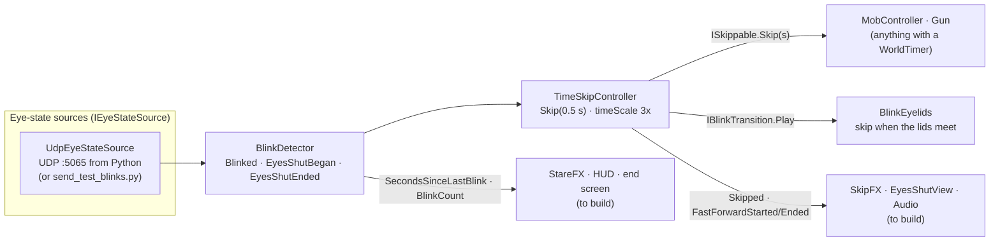

# BLINK: Architecture

How the code is split, how the pieces talk to each other, and who owns what. The [README](../README.md) covers the design.

The core is already working end to end: the webcam sidecar's UDP messages drive the blink detector, which drives time skips, which move the zombies and finish reloads. Every workstream below plugs into that core through **events and interfaces**, so people can build in parallel without editing each other's files.

## Try it

1. Open `Unity/Assets/Scenes/Sandbox.unity` and press Play.
2. Controls:

| Input | Action |
|---|---|
| WASD / left stick | Move |
| Mouse / right stick | Look |
| Left click / right trigger | Shoot / swing the axe |
| R / gamepad X (West) | Reload (on a pad, X interacts instead while something usable is in focus) |
| G / d-pad down | Drop whatever is in your hand (one hand: picking something up swaps it for what you hold) |
| E / gamepad X (West) | Interact (hold to force a door), with any weapon. Reading a note: E / X, or B on a pad, puts it down |
| **Blink** (webcam) | World skips 0.5 s |
| **Eyes shut** (webcam) | World runs at 3× until you open them; the pad rumbles with your heartbeat the whole time |
| Look away from the webcam | Nothing: no face counts as eyes open |
| F1 | Toggle the blink debug overlay |
| Esc | Free the cursor (click to lock again) |

   There is no keyboard blink any more (`Space` is Jump). Blinking only comes from the webcam; without one, use `blink_server/send_test_blinks.py` (step 4).

3. **Real webcam:** run the setup once from the repo folder. After that, pressing Play starts the webcam sidecar automatically (in the Editor on Windows and macOS; the face model downloads itself on first run).
   - Windows: `powershell -ExecutionPolicy Bypass -File blink_server/setup.ps1`
   - macOS / Linux: `sh blink_server/setup.sh` (needs Python 3.13 or 3.12). macOS asks for camera access the first time: allow it for your terminal when testing with `--preview`, and for Unity when Play starts the sidecar. If it picks the wrong camera (e.g. an iPhone via Continuity Camera), pass `--camera 1`.
   - **Tuning:** to see the camera and blink score, untick `launchSidecar` on the `UdpEyeStateSource` in GameSystems (so there aren't two senders), then run the venv's python (`blink_server/.venv/Scripts/python` on Windows, `blink_server/.venv/bin/python` on macOS) with `blink_server/blink_server.py --preview` while in Play mode. Too twitchy or not triggering? Tune `--close` / `--open`.
     - Windows, from the repo root: `cd blink_server` then `.venv\Scripts\python.exe blink_server.py --preview` (`q` / Esc closes it).
     - The preview shows `CLOSED`/`open`, the blink score and `turn` (degrees the head points away from the camera).
   - **Looking away counts as eyes open:** if your head is turned more than `--max-turn` degrees (default 30) from the camera, the sidecar sends `closed: false` whatever the blink score says. The blink score is unreliable side-on, and you're not looking at the screen anyway. The preview adds `(AWAY)` when this kicks in. If the camera loses your face altogether (`present: false`), Unity also counts the eyes as open: looking away never blinks or fast-forwards (see `BlinkDetector` below).
4. **No webcam:** this is the only way to blink without one. While in Play mode, run `python blink_server/send_test_blinks.py demo` (or `blink`, `hold 2`, `away 1`, `open 5`). `blink` also gets you past "BLINK to begin".

## Data flow



## Zombie senses

- **Patrol:** set `patrolRoute` on a zombie's `MobController` to an empty whose children are waypoints. It loops them, pausing at each. No route = stands still.
- **Sight:** chases when you're inside `sightRange` and its view cone with nothing in the way (or within `touchRange`). Out of sight for `loseSightTime` = goes to where it last saw you.
- **Noise:** call `Noise.Make(position, loudness)` from anything. Loudness is the audible range in metres, measured as walking distance on the navmesh, so walls muffle it; a route through a closed door blocks it entirely (`Noise.MuffledByDoor`; a door still hears its own rattle). Zombies that hear it (and can't see you) walk over and search. Add a `NoiseSource` to props for drop/impact noise, or call its `Emit()` from cupboards etc.
- Current sources: pistol shot 35, axe hitting something 6, dry-fire 4, forcing a door 10/s, door bursting open 20. All Inspector fields. The player's footsteps are silent (sprint was removed).

## Hit reactions

- **Living zombies (`ZombieHitReaction`, on the Zombie root):** every `Hitbox.Struck` flinches the bones away from the shot (torso bend and twist, head whip, arm swing, knee buckle), layered on top of the animation in `LateUpdate`, plus a short stagger (slower agent, small slide back). The axe hits harder (via `PlayerWeapons.MeleeHit`). Stops the instant the zombie dies so the ragdoll takes over.
- **Corpses (`CorpseShotReaction`, creates itself once per scene):** re-casts each shot and axe sweep against the `Corpse` layer and shoves the limb it finds, waking a settled ragdoll and re-freezing it after it settles. Bullets still carry on to their target.
- Details, tuning knobs and time-skip behaviour: [HIT_REACTIONS.md](HIT_REACTIONS.md).

## Folder map

```
blink_server/                  Python webcam sidecar (send_test_blinks.py = fake sender)
docs/                          ARCHITECTURE.md, FEEL_KIT.md (sounds, music, haptics, VFX to use)
Unity/Assets/
  Scripts/                     Blink.Runtime assembly (namespace Blink.*)
    Detection/                 eye-state sources, BlinkDetector, BlinkClassifier, debug overlay
    TimeSkip/                  TimeSkipController, ISkippable, IBlinkTransition, WorldTimer
    Effects/                   BlinkEyelids (+ EyelidTimeline), BulletTracer, Blood*, GamepadHaptics, FilmGrain (subtle screen grain)
    Player/                    PlayerController
    Mobs/                      MobController, NavPathUtility, ZombieRagdoll, RagdollSkipper
    Combat/                    Health, IDamageable, Hitbox, PlayerWeapons (hub), Gun, MeleeWeapon, view models
  Tests/EditMode/              unit tests (Window > General > Test Runner)
  Prefabs/                     Player, Zombie, GameSystems  <- the integration points
  Scenes/Sandbox.unity         test level with a baked navmesh
  Art/Placeholders/            low-poly placeholder models (generated, see Editor/)
  Editor/                      editor tools
```

## The contracts

### Detection (`Blink.Detection`)
- **`IEyeStateSource`**: `IsActive`, `Current` (`EyeState { Present, Closed }`), `SourceName`. Put any component implementing it on the same GameObject as `BlinkDetector` and it's used automatically. Eyes count as closed if *any* active source with a face in view says so. The only source in the game is `UdpEyeStateSource` (the webcam); the keyboard source was removed because `Space` is Jump.
- **`BlinkDetector`** (singleton: `BlinkDetector.Instance`)
  - Events: `Blinked` (quick blink, fired on reopen), `EyesShutBegan` (closed past 0.2 s), `EyesShutEnded(float closedSeconds)`.
  - State: `EyesClosed`, `EyesShut`, `BlinkCount`, `SecondsSinceLastBlink` (for stare effects), `ActiveSourceName`.
  - Inspector: hold threshold, noise filter, "treat missing face as closed" (**off** by default).
  - **Looking away = eyes open.** No face in view (`present: false`) counts as open, whatever `closed` says: no blink, no eyes-shut, no fast-forward. If the face goes while the eyes are closed (`EyeStateMerger` notices the source that saw them closed lost the face, then `BlinkClassifier.LoseFace`):
    - mid-blink (under the hold threshold): the closure is dropped, **no** `Blinked`, so no skip. Nobody saw the eyes reopen, and a head turning away often reads as a closing eye;
    - while shut: `EyesShutEnded` fires once, so fast-forward, the muffle and the rumble stop cleanly;
    - when the face comes back it starts fresh: eyes open = nothing, eyes closed = a new closure (the hold threshold counts from its return).
    The webcam going quiet (no packets for 0.5 s) is handled the same way.
- **UDP protocol** (Python → Unity, `127.0.0.1:5065`, ~30 Hz, one JSON object per datagram):
  ```json
  {"t": 1731000000123, "present": true, "closed": false}
  ```
  The sidecar does the open/close hysteresis; Unity does the blink-vs-hold timing. With several people in view, the sidecar tracks the closest (largest) face. If packets stop for 0.5 s, the webcam source goes inactive and the keyboard still works.

### Time (`Blink.TimeSkip`)
- **`TimeSkipController`** (singleton)
  - A blink calls `Skip(0.5)` on every registered `ISkippable`, then raises `Skipped(float seconds)`.
  - `Transition` (static, optional `IBlinkTransition`): when set, a blink plays it and the skip happens once the screen is covered, so the jump is hidden. `BlinkEyelids` (Effects, on GameSystems) sets itself: black lids close from the top and bottom (0.07 s) and open again as soon as they meet (0.1 s), all on unscaled time. Blinking again while shut keeps them shut and skips straight away.
  - Eyes shut sets `Time.timeScale = 3` and raises `FastForwardStarted`; reopening restores 1 and raises `FastForwardEnded(bool interrupted)`.
  - `InterruptFastForward()`: called when a zombie hits you while your eyes are shut. Time snaps back to 1× until you open your eyes.
  - `IsFastForwarding`, `TotalSkippedSeconds`.
- **`ISkippable.Skip(float seconds)`**: do in one go whatever Update does with `Time.deltaTime`. Register in `OnEnable`, unregister in `OnDisable`:
  ```csharp
  void OnEnable()  => TimeSkipController.Register(this);
  void OnDisable() => TimeSkipController.Unregister(this);
  public void Skip(float seconds) => myTimer.Advance(seconds);
  ```
- **`WorldTimer`**: serializable countdown for anything blinking can speed up (reload, bandage, door, generator). `Start / Pause / Resume / Cancel / Advance(seconds)`, `Progress01`, `Completed` event. Call `Advance(Time.deltaTime)` in Update and `Advance(seconds)` in Skip.

**Time rule:** world things (zombies, timers) use **scaled** time, so fast-forward speeds them up for free. The **player stays out of world time**: `PlayerController` is not an `ISkippable` and moves on real time, so neither a blink nor fast-forward moves the player. Camera, UI, effects, eyelids and audio cues that must not speed up also use **unscaled** time (`Time.unscaledDeltaTime`).

### Combat (`Blink.Combat`)
- **`IDamageable`**: `IsDead`, `TakeDamage(amount, point, direction)`. Bullets find it with `GetComponentInParent`.
- **`Hitbox`**: an `IDamageable` on one body-part collider (a zombie's ragdoll bones). Forwards `damage x multiplier` to the `Health` on a parent and raises `Struck` first, so the ragdoll knows where the killing shot landed. **`IsHead`** (set by `ZombieRagdoll` on the head bone): any damaging hit there kills outright, so a headshot is a one-shot kill with every weapon (the pistol and the axe). `Hitbox.IsHeadCollider(collider)` lets effects tell.
- **`Health`**: `Damaged(amount, point)`, `Healed(amount)`, `Died`; `Current`, `Max`, `Fraction`, `Heal()`, `ResetHealth()`.
- **`PlayerWeapons`** (on the Player root; `PlayerWeapons.Instance`): the weapon hub. Owns the loadout, the input, the switch and which weapon is out, and re-raises every weapon's events as **weapon-agnostic events**. Listen here, not to a weapon:

  | Event | When |
  |---|---|
  | `ShotFired(WeaponKind)` | once per trigger pull of a gun (after its rays): recoil, gunshot sound, rumble |
  | `RayFired(ShotRay)` | per hitscan ray (one per pistol shot), after its damage. `Hit`, `Info`, `Ray`, `Range`, `Muzzle`, `EndPoint`, `Target`, `IsHead`. Tracers, blood, hit markers, impact sounds |
  | `MeleeSwing(WeaponKind)` | an axe swing starts (whoosh) |
  | `MeleeHit(MeleeHitInfo)` | the swing connects, after its damage: `Point`, `Normal`, `Direction`, `Collider`, `Target` (null = wall), `Killed`, `IsHead` |
  | `DryFired`, `ReloadStarted`, `ReloadFinished(WeaponKind)` | as on `Gun`, for the pistol |
  | `SwitchStarted(from, to)` / `WeaponSwitched(from, to)` | the old weapon starts going down / the new one is out and rising |

  `ActiveWeapon` (`IWeaponStatus`: `Kind`, `UsesAmmo`, `AmmoLoaded`, `AmmoCapacity`, `AmmoReserve`, `IsReloading`, `ReloadProgress01`), `ActiveKind`, `IsSwitching`, `Select(kind)`, `Cycle(±1)`.
- **Slots** live under `Player/CameraPivot/Camera/Weapons/Holster` (`Weapons` gets `CameraFeel`'s view model bob, `Holster` is lowered by the hub); only the one in hand is active:
  1. **Hands** (`ViewModel_Hands`, `HandsViewModel`): our arms relaxed and open at the bottom corners, breathing sway. No attack.
  2. **Pistol** (`Gun` + its `ViewModel`): unchanged. The hub turns `Gun.ReadsInput` off and calls `TryFire`/`TryStartReload`; `Gun`'s own events still fire, so `GunViewModelAnimator` is untouched.
  3. **Axe** (`MeleeWeapon` + `ViewModel_Axe`): 60 damage, once per swing, on `AxeViewModel.StrikeApex` (also when a blink skips past it): a 0.35 m sphere swept 1.8 m from the eye picks the nearest living hitbox in sight, else the nearest wall (a thud). No ammo. The damage goes through the struck `Hitbox`, so `Hitbox.Struck` fires (hit point, view direction) just as for a bullet.
- **One hand** (`oneHanded`, on by default; `Interaction.Hand` on the Player, added by the `Interactor`): the player holds one thing at a time: a `Pickup` item (key, candle), the pistol, a melee item or a `Carryable`. Taking anything drops what's held first (prompts read "Swap key for pistol"), G / d-pad down drops it, and there is no weapon switching (1/2/3, wheel, bumpers do nothing). A held item shows bottom right on the hands (`HandsViewModel.HoldPoint`) and is in the `Inventory` while held; a locked `Openable` uses its key up (`consumesKey`). Dropping the pistol puts its `Pickup` back on the floor, ammo kept. The player starts with empty hands (`startsWithPistol`, `startsWithAxe` off).
- **Switching** (only with `oneHanded` off): a 0.12 s lower and 0.14 s raise on unscaled time (the player's hands are outside world time). A reload is dropped when its gun is put away; a swing finishes before the switch starts. No switching or attacking during the grab QTE or once dead.
- **`Gun`**: hitscan from screen centre (34 damage, so 3 shots kill a 100 HP zombie). Events `Fired(bool hit, RaycastHit)`, `DryFired`, `ReloadStarted`, `ReloadFinished`; `AmmoInMagazine`, `ReserveAmmo`, `ReloadProgress01`, `Muzzle`, `Range`, `CancelReload()`. Reload is a `WorldTimer`, so blinking finishes it faster. Won't fire once its owner is dead. On its own (no hub) it reads its own input.
- **Placeholder feedback** (IMGUI, no Canvas; replace freely, they only listen to the events above):
  - `GunHud` (on Player): crosshair with a hit marker (red on a kill) from any weapon, the active gun's name, ammo and reload bar (nothing for the hands and the axe), player HP.
  - `BulletTracer` (GameSystems) draws a tracer per `RayFired` ray (one smoke wisp per shot); `BloodImpactSpawner` (Effects) bursts blood per damaging ray and per axe `MeleeHit`. Headshots get a much stronger burst (bigger, denser, extra fanned bursts, bigger exit spray, always a floor splat; `HeadshotBlood` settings).

### Player (`Blink.Player`)
- **`PlayerController`**: CharacterController movement driven by the project-wide input actions (`Player/Move`, `Player/Look`, `Player/Sprint`). Does **not** move during time skips: it isn't an `ISkippable` (a blink leaves it in place) and movement runs on real time (`PlayerController.RealDeltaTime`), so fast-forward doesn't speed it up. `Velocity`, `IsSprinting`, `InputEnabled` (turned off on death), `SpeedMultiplier` (1 = normal; the flooded basement sets 0.7 while wading).
- **`CameraFeel`** (on the Camera): recoil per `ShotFired`, a small jolt on `MeleeHit`, the reload dip while a gun reloads (from `ActiveWeapon.ReloadProgress01`), head bob and strafe tilt.
- **`WakeUpSequence`** (on GameSystems): the opening wake-up and the respawn. Static `Respawned` is raised once the player is back in bed and healed after a death (screen black, carried items already returned): puzzles reset themselves there. `NextRespawnPrompt` overrides the next respawn screen's text once (Lily's doll uses *"Lily wanted to play"*). `SetCheckpoint(position, rotation)` makes the next respawns wake there (lying on the floor) instead of the bed until `ClearCheckpoint()`; nothing uses it at the moment (basement deaths go back to bed too).
- **`GrabQte`** (creates itself): the grab when a zombie reaches you because you blinked. Freezes the world (timeScale 0), yanks the camera onto the zombie's face (`PlayerController.TurnTowards`) and jolts it on every bite (`CameraFeel.AddJolt`), under a dark vignette. After a 0.6 s scare, a white ring closes onto a red target somewhere on screen with a key in its middle; press that key as they meet (±0.15 s, ring meets the target 1.2 s after appearing). Keys go by position: W/A/S/D on the keyboard, Y/X/A/B on the gamepad's face buttons (`GrabKey` Up/Left/Down/Right), never the same twice running; the label follows the device you last pressed. Each hit shoves the zombie back and the next ring jumps elsewhere with a new key. The wrong key (several at once counts as the wrong one), bad timing or a ring left to pass is a bite: the zombie's `attackDamage` off your HP with a red flash (the only red flash), then the next ring. Being grabbed drops whatever you're carrying (`Carryable.DropHeld`) and `PlayerWeapons` swaps to the hands, which brace against it and shove on every hit; the weapon comes back 0.4 s after you break free. 3 hits escape: a two-handed shove (`BrokeFree`) flings it back a few metres as a ragdoll 0.08 s later, while the world is still frozen, then time eases through slow motion back to full speed before you get control back. It isn't hurt: it lies stunned and gets up to come for you again. Die from the bites and time eases back over your body. Timing is the pure `GrabRing` (unit tested). The grabber implements `IGrabber` (`GrabFacePoint`, `GrabBite(hurts)`, `GrabShoved(final)`, `GrabThrown(away)`, `GrabResolved`). `BlocksInput` keeps the presses from counting as blinks or shots; static events `Began`, `Bit(hurts)` (each bite lunge), `Beat` (each hit), `BrokeFree` (the last hit) and `Resolved(escaped)` for the hands, audio and rumble.
- **`GamepadHaptics`** (on Player): controller rumble for blinks, shots, axe hits, dry fire, reload, damage, the grab QTE (biggest jolt when `GrabQte.Active` turns on, then a thump on every `GrabQte.Bit` and a heavy one on `GrabQte.BrokeFree`), forcing and bursting the jammed door, and **continuous rumble for the whole eyes-shut fast-forward** (`EyesShutRumble`: a low drone plus a lub-dub on every beat of `PlayerAudio`'s heartbeat, so you feel exactly the beats you hear; a grab interrupting fast-forward gives a hard jolt, then stops). It is the only thing that sets the motors: layers and one-shot pulses mix by per-motor max. Unscaled time. **Strength** (0–2) scales everything. Motors are reset on disable, pause, focus loss, quit and pad change. DualSense/DS4 rumble only over USB. Patterns: [FEEL_KIT.md](FEEL_KIT.md#controller-haptics).
- **`JammedDoor`** (World): hold Interact to force it on a `WorldTimer`. Exposes `IsForcing`, `Progress01` and an `Opened` event for sound, rumble and dust.

### Mobs (`Blink.Mobs`)
- **`MobController`**: Idle → Chase → Attack → Dead on a NavMeshAgent.
  - On a skip it jumps along its navmesh path by speed × seconds, and can land a hit if it was already in range.
  - Reaching you because you blinked starts a `GrabQte` instead of plain damage. It's the `IGrabber`: while the world is frozen it takes its body off the agent, slams in to `grabDistance` (0.7 m) in front of you, the camera locked between its eyes, restarts its `Attack` clip on every bite with the Animator on unscaled time, and lunges (`biteLunge`) or flinches back (`shoveDistance`) on GrabQte's cues. A bite that hurts deals `attackDamage`; breaking free (`GrabThrown`) hands it back to the agent and `KnockDown`s it: flung back at `grabEscapeThrow` (3 m/s) plus `grabEscapeLift` (1.5 m/s up) from the chest so it tips over backwards and lands about 3 m from you, then stunned for `grabEscapeStun` (3 world s) before it stands up where it landed and investigates you. Letting go never snaps the body: the agent is warped to wherever the grab left it.
  - Hiding (`Interaction.HidingSpot`, static `Occupant`): every zombie goes blind to you and searches your last-seen point, so blinking or holding your eyes shut inside is safe. A zombie that could see you as you got in (`KnownHidingSpot`) searches at the spot's `ExitPoint` instead, then gives up and wanders. Nothing pulls you out: `MobController.Attack` bails while `HidingSpot.Occupant` is set, so no grab or damage starts on a hidden player.
    - Inside, the screen is black around a soft `peekGap` (IMGUI): tall and thin for a door, wide and low under a bed. In the bungalow the doors are baked into the mesh, so the dark also hides the camera passing through them.
  - Events `StateChanged(State)`, `Attacked`.
  - On death: agent and root collider off. With a `ZombieRagdoll` it goes limp (see below); without one it plays the `Dead` clip, or falls over procedurally when there's no `Dead` param. The body is removed after `corpseLifetime` world seconds (6 s). It stays an `ISkippable`, so blinking makes bodies vanish sooner.
  - Animation hook: if the Animator has a float `Speed`, a trigger `Attack` or a bool `Dead`, they're set automatically. Build an Animator Controller with those parameters and it just works.
- **`ZombieRagdoll`** (on the Zombie root; bones built with Unity's Ragdoll wizard): while alive the bone bodies are kinematic and each bone collider gets a `Hitbox`. On death the Animator stops and the bodies go limp with the zombie's running speed, knocked back by the killing shot (`knockbackSpeed`, `hitImpulse`). The body freezes once at rest or after `settleSeconds` (3 s) of world time. A killing **axe** blow (reported by `PlayerWeapons.MeleeHit`) also launches the body several metres along the swing (`axeLaunchSpeed`, `axeLaunchLift`, `axeHitImpulse`), with continuous collision while it flies. It's the same flight as a melee-prop knockdown (`Launch`), which never freezes and gets up instead (`GetUp`); see [HIT_REACTIONS.md](HIT_REACTIONS.md). `RagdollSkipper` (on GameSystems) steps physics on a blink so falling bodies jump forward too.
- **Layers**: `Zombie` (root capsule: blocks the player, not bullets), `ZombieHitbox` (bone colliders while alive: collide with nothing, only raycasts), `Corpse` (bone colliders once dead: level and other corpses only), `Player`. The gun's `hitMask` skips `Zombie`, `Corpse`, `Player` and `Ignore Raycast`, so shots land on limbs and pass over bodies. A zombie without a ragdoll must keep its root on `Default` to stay shootable.
- Levels need a **NavMeshSurface** (AI Navigation package, already installed) baked over the floor.

### Doors (`Blink.World`)
Walk-through hinged doors (the bungalow's D1–D5). Cupboards and drawers stay `Openable`; the mansion's forced bedroom door stays `JammedDoor`. In `House_Bungalow` the front door D1 is a `Door`; `FrontDoor` (above) is not set up there, and Setup Doors strips any `FrontDoorPart` from a leaf it owns.
- **`Door`** (on `Bungalow/Doors/<id>`, at the doorway) swings one or two leaves that stay in the shell FBX, so a re-export keeps the door. Each leaf carries a **`DoorLeaf`** (the `IInteractable` the look ray hits), which forwards to its `Door`. All the state and maths are in the pure **`DoorModel`** (unit tested).
- **Interact** opens it (an eased 0.5 s swing after a 0.1 s hand delay, ease-out-back), closes it, rattles it if locked, or puts a key in. Prompts: `Open door` / `Close door` / `Locked · n/3 keys` / `Use key · n/3 keys` (holding one that won't finish it) / `Unlock door` (the last key) / `Locked` (a story lock or a one-key door), in the `BlinkPrompts` stack. The pad's X reaches it through `Interactor` and `SharedPress` like any other target.
- **Time:** unscaled, like pickups and the glint, so it swings at full speed during eyes-shut fast-forward (3×) and while the wake-up or a grab freezes the world (timeScale 0).
- **The player is never swept:** it opens away from whoever pressed, or the other way if that arc is occupied (else `Blocked`); a close is refused while they stand in the arc; a moving leaf holds while they are in what is left of its swing. The test is a plan-view disc (the capsule radius + 5 cm) against the leaf's arc, on the door's storey only.
- **Locks:** `keysRequired` keys, each one `keyItemId` or any id in `alsoFits`. The player has one hand, so keys go in one at a time, in any order: each press with a fitting key uses it up in the lock (`Hand.UseUp`, so a death can't put it back; `KeyUsed(used, needed)`), and the last one unlocks it. After that it is an ordinary door. `keysRequired` 0 = a story lock no key opens. In the bungalow: D1 takes one key per puzzle room (`key_dorm` from Lily's doll, `key_workshop` from the flooded basement, `key_front_3` from the third room), D2 takes 1 × `key_bedroom` (on the chest of drawers, BLINK/Bungalow/Set Up Start Bedroom), D4 is a story lock. Every door starts shut. From code, `Slam(seconds)` swings it shut fast and story-locks it, `Unlock()` frees it (the flooded basement does this to D5 while the water's in).
- **Events:** `Unlocked` / `onUnlocked` (the hook for a future ending: unlocking or opening D1 does nothing else yet), `Opened(byPlayer)` / `onOpened`, `Closed`, `Rattled`, and static `PlayerUsed(door, DoorResult)` for rumble and sound (`GamepadHaptics` listens). Moving or rattling a door by hand makes a `Noise` (6 m / 8 m).
- **Zombies** are NavMesh agents, so colliders don't stop them. Every leaf is left out of the navmesh bake and carries a carving `NavMeshObstacle` that the `Door` switches on while it is locked (the doorway is cut) or open and still (the open leaf is cut, so they walk round it), and off while it is closed and unlocked (they path through it). A zombie whose path crosses the doorway shoves it open from 1.9 m away; one a blink skip warps through it leaves it open behind it.
- **Setup:** **BLINK/Bungalow/Setup Doors** (`BungalowDoorSetup`, idempotent) finds the leaves by name (`D1_LeafL`, `D2_Leaf`...), takes the hinges from the leaf collider boxes and the layout's openings, and the lock/open state and key items from `DOOR_STATE` in `bungalow_layout.py`. It measures how far each side can swing before a leaf meets a wall, the jamb or furniture (the bungalow's doors: 90° to the front, 70° to the back, where the hinge side meets the jamb). A keyed door is only locked if the scene holds enough fitting keys (else it is left unlocked and the report says so), so nobody is shut in: place the keys first (Set Up Start Bedroom, Place Puzzle: Lily's Doll, Place Puzzle: Flooded Basement, Place Front Door Keys), or run it again after. It makes each leaf non-static (light probes, Contribute GI off), adds the kinematic Rigidbody, `DoorLeaf`, obstacle and `NavMeshModifier`. Re-bake the navmesh afterwards. **Place Front Door Keys (placeholder)** puts stand-in `KeyPickup`s for the puzzle rooms not built yet (`key_front_3`; the flooded basement gives the real `key_workshop`) under `Keys_Placeholder`; drop a row from `KeySpots` when its room hands out the real key. Set Up Start Bedroom places the bedroom key and note, then runs Setup Doors so D2 locks.

### UI theme (`Blink.UI`, `Scripts/UI/`)
All in-game UI is IMGUI drawn through one theme, so the look is retuned in one place. The style is restrained and western-serif: off-white "bone" text with a soft shadow, muted grey for secondary text, one deep red accent, short eased fades on unscaled time, and nothing on screen unless it matters.
- **`BlinkThemeAsset`** (`Assets/Art/UI/Resources/BlinkTheme.asset`, loaded automatically): fonts (Cormorant SC and EB Garamond, OFL, see the README credits), palette, `uiScale`, type sizes, reticle sizes and fade timings. Edit it in Play mode to retune live.
- **`BlinkTheme`** (static): the asset, `Scale` (screen height / 1080 × `uiScale`), `Px(size1080)`, `PxText` (type never shrinks below `minTextScale`), palette (`Bone`, `Muted`, `Accent`, `Ink`, `Paper`...), cached styles (`Title`, `Heading`, `Subtitle`, `Prompt`, `SmallCaps`, `Body`, `Number`, `Key`), easing and `StepFade`/`Linger` helpers, and drawing primitives: `Text`/`SpacedText` (letterspaced, soft shadow), `Rule`, `RoundedRect`, `CornerShade` (soft darkening behind corner HUD so it reads over bright scenes), and anti-aliased GL `Disc`, `Ring`, `Arc`. Call the drawing helpers from OnGUI on Repaint.
- **`BlinkWidgets`**: the pieces, each taking plain state: `Reticle` (soft dot), `HitRing` (bone on a hit, red on a kill, larger on a headshot), `KeyCap` (with an optional hold ring), `PromptRow`, `Ammo`, `HealthCore`, `Clock`, `Inventory`, `TitleCard` (title/death screens), `NoteCard` (aged paper), `QteTarget`/`QtePips`/`Banner` (grab QTE), `DebugPanel`.
- **`BlinkPrompts`**: the bottom-right prompt stack. Call `BlinkPrompts.Show(owner, action, fallbackKey, label, progress, order)` every frame from Update/LateUpdate while the prompt applies (`action` and `fallbackKey` both null = a muted statement; `progress` 0..1 = hold ring). With an `InputAction`, the glyph follows the device in use. Rows fade and slide in and out by themselves; `ReserveBottom(px)` keeps them above the ammo. Drawn by a `BlinkPromptHud` that creates itself.
- **`BlinkInput`**: controller support for the UI. `UsingGamepad` flips live on real input (sticks past a dead zone, buttons, triggers; mouse movement or keys flip it back). `GlyphFor(action, fallbackKey)` reads the action's actual bindings (overrides included) for that device. Gamepad glyphs are device-neutral and drawn in code: face buttons and the d-pad by position (a four-dot diagram with the button filled), `LB`/`RB`/`LT`/`RT` pills, `L`/`R` sticks. The grab QTE shows W/A/S/D or the face button in the same position.
- **Pad layout (shooter style):**
  - **X (West)** is Interact *and* Reload. It interacts when something usable is in focus: the look target, a jammed door in reach, getting out of a hiding spot, or a note held up. Otherwise it reloads. `SharedPress` decides the owner once, when the button goes down, and keeps it until release, so one press never does both. `Interactor.InteractOwns`/`ReloadOwns` are what `PlayerWeapons` and `JammedDoor` check.
  - **Y (North)** swaps to the next weapon (as do RB and d-pad right).
  - **A** jumps.
  - **B** crouches, and also puts a note down. That press doesn't crouch (`Readable.ClaimsCrouch`).
  - Keyboard is unchanged: E interacts, R reloads.
- **`NotePaper`**: procedural worn paper for `Readable` notes. Each seed (from the note's text, or `paperSeed`) gives a different sheet: torn side, nick, dog-ear, creases, stains, grime, a broken border and patchy ink. It is baked on a worker thread from `Readable.Start` and cached. `LiftPose` is the pure lift/drop/sway animation (unscaled time).
- Users: `GunHud`, `WakeUpSequence`, `GrabQte`, `Interactor`, `Inventory`, `Readable`, `JammedDoor`, `ClockHud`, `BlinkDebugOverlay`. `GunHud` and `ClockHud` have a `themeColors` toggle to fall back to their own colour fields.

## Workstreams

Each workstream owns its folder and builds against the contracts above. Integration happens through the three prefabs. Asset picks (with licences and hooks) for workstreams 2–4 are in [FEEL_KIT.md](FEEL_KIT.md).

| # | Workstream | Owns | First tasks | Hooks into |
|---|---|---|---|---|
| 1 | **Blink sidecar** (Python) | `blink_server/` | `blink_server.py`: MediaPipe Face Landmarker → `eyeBlinkLeft/Right` blendshapes → hysteresis (close > 0.5, open < 0.35), forced open when the head is turned > 30° (`--max-turn`) → UDP packets. Python 3.12, `requirements.txt`, `--camera`, `--preview`. Then a PyInstaller build Unity can launch. | UDP protocol above. Test with the F1 overlay. |
| 2 | **Player & gun feel** | `Scripts/Player/`, `Scripts/Combat/` | Muzzle flash, recoil, gunshot sound, hit sparks, ammo/health HUD, damage vignette, death → restart. | `Gun` events, `Health` events |
| 3 | **Zombies** | `Scripts/Mobs/`, `Art/Zombies/` | Real zombie model (see asset research), Mixamo walk/attack/death clips, Animator Controller with `Speed`/`Attack`/`Dead`, spawner, grab jump-scare. | `MobController` events + Animator params, `ISkippable` for spawners |
| 4 | **Time FX & audio** | `Scripts/Effects/` (new) | SkipFX (hard cut, chromatic flash, ghost trails, sound hit), EyesShutView (dark red-silhouette view for spectators), StareFX (blur + red veins after ~8 s), heartbeat. | `TimeSkipController.Skipped / FastForwardStarted / FastForwardEnded`, `BlinkDetector.SecondsSinceLastBlink` |
| 5 | **Level, objectives & flow** | `Scripts/Objectives/`, `Scripts/Flow/` (new), level scenes | Hospital level + navmesh, door / bandage / generator objectives on `WorldTimer`, title ("Blink to begin"), end screen ("You escaped in N blinks"). | `WorldTimer` + `ISkippable`, `BlinkDetector.Blinked`, `BlinkDetector.BlinkCount` |

## Working together without merge pain

- **Scenes don't merge.** Each person works in their own scene (`Assets/Scenes/Dev/<name>.unity`) built from the shared prefabs. Only one person edits the real level scene at a time.
- **Prefabs are the integration points.** Add your components to `Player`, `Zombie` or `GameSystems` (or to a nested prefab inside them) rather than wiring things only inside a scene.
- **New scripts go under `Scripts/<area>/`** in the `Blink.<Area>` namespace. They compile into the `Blink.Runtime` assembly automatically. If you need a new package in code, add its assembly to `Scripts/Blink.Runtime.asmdef` references.
- **Pure logic gets a test** in `Tests/EditMode/` (see the existing ones for the pattern). Run them from Window > General > Test Runner.
- Commit messages use Conventional Commits (`feat(mobs): add spawner`, `fix(blink): ...`).
