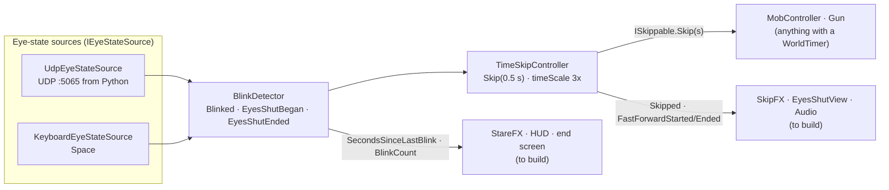

# BLINK: Architecture

How the code is split, how the pieces talk to each other, and who owns what. Read [GAME_PLAN.md](GAME_PLAN.md) for the design.

The core is already working end to end: the webcam sidecar's UDP messages (or the `Space` key) drive the blink detector, which drives time skips, which move the zombies and finish reloads. Every workstream below plugs into that core through **events and interfaces**, so people can build in parallel without editing each other's files.

## Try it

1. Open `Unity/Assets/Scenes/Sandbox.unity` and press Play.
2. Controls:

| Input | Action |
|---|---|
| WASD / left stick | Move |
| Mouse / right stick | Look |
| Shift | Sprint |
| Left click / right trigger | Shoot |
| R / gamepad West | Reload |
| **Space: tap** | Blink (world skips 0.5 s) |
| **Space: hold** | Eyes shut (world runs at 3× until released) |
| F1 | Toggle the blink debug overlay |
| Esc | Free the cursor (click to lock again) |

3. To test the webcam path without a webcam, run `python blink_server/send_test_blinks.py demo` while in Play mode.

## Data flow



## Folder map

```
blink_server/                  Python webcam sidecar (send_test_blinks.py = fake sender)
docs/                          GAME_PLAN.md, ARCHITECTURE.md
Unity/Assets/
  Scripts/                     Blink.Runtime assembly (namespace Blink.*)
    Detection/                 eye-state sources, BlinkDetector, BlinkClassifier, debug overlay
    TimeSkip/                  TimeSkipController, ISkippable, WorldTimer
    Player/                    PlayerController
    Mobs/                      MobController, NavPathUtility
    Combat/                    Health, IDamageable, Gun
  Tests/EditMode/              unit tests (Window > General > Test Runner)
  Prefabs/                     Player, Zombie, GameSystems  <- the integration points
  Scenes/Sandbox.unity         test level with a baked navmesh
  Art/Placeholders/            low-poly placeholder models (generated, see Editor/)
  Editor/                      editor tools
```

## The contracts

### Detection (`Blink.Detection`)
- **`IEyeStateSource`**: `IsActive`, `Current` (`EyeState { Present, Closed }`), `SourceName`. Put any component implementing it on the same GameObject as `BlinkDetector` and it's used automatically. Eyes count as closed if *any* active source says closed.
- **`BlinkDetector`** (singleton: `BlinkDetector.Instance`)
  - Events: `Blinked` (quick blink, fired on reopen), `EyesShutBegan` (closed past 0.35 s), `EyesShutEnded(float closedSeconds)`.
  - State: `EyesClosed`, `EyesShut`, `BlinkCount`, `SecondsSinceLastBlink` (for stare effects), `ActiveSourceName`.
  - Inspector: hold threshold, noise filter, "treat missing face as closed" (on by default: looking away lets time pass).
- **UDP protocol** (Python → Unity, `127.0.0.1:5065`, ~30 Hz, one JSON object per datagram):
  ```json
  {"t": 1731000000123, "present": true, "closed": false}
  ```
  The sidecar does the open/close hysteresis; Unity does the blink-vs-hold timing. If packets stop for 0.5 s, the webcam source goes inactive and the keyboard still works.

### Time (`Blink.TimeSkip`)
- **`TimeSkipController`** (singleton)
  - A blink calls `Skip(0.5)` on every registered `ISkippable`, then raises `Skipped(float seconds)`.
  - Eyes shut sets `Time.timeScale = 3` and raises `FastForwardStarted`; reopening restores 1 and raises `FastForwardEnded(bool interrupted)`.
  - `InterruptFastForward()`: called when a zombie hits you while your eyes are shut. Time snaps back to 1× until you open your eyes.
  - `IsFastForwarding`, `TotalSkippedSeconds`.
- **`ISkippable.Skip(float seconds)`**: do in one go whatever Update does with `Time.deltaTime`. Register in `OnEnable`, unregister in `OnDisable`:
  ```csharp
  void OnEnable()  => TimeSkipController.Register(this);
  void OnDisable() => TimeSkipController.Unregister(this);
  public void Skip(float seconds) => myTimer.Advance(seconds);
  ```
- **`WorldTimer`**: serializable countdown for anything blinking can speed up (reload, bandage, door, generator). `Start / Pause / Resume / Cancel / Advance(seconds)`, `Progress01`, `Completed` event. Call `Advance(Time.deltaTime)` in Update and `Advance(seconds)` in Skip.

**Time rule:** world things (zombies, timers) use **scaled** time, so fast-forward speeds them up for free. The **player stays out of world time**: `PlayerController` is not an `ISkippable` and moves on real time, so neither a blink nor fast-forward moves the player. Camera, UI, effects, eyelids and audio cues that must not speed up also use **unscaled** time (`Time.unscaledDeltaTime`).

### Combat (`Blink.Combat`)
- **`IDamageable`**: `IsDead`, `TakeDamage(amount, point, direction)`. Bullets find it with `GetComponentInParent`.
- **`Health`**: `Damaged(amount, point)`, `Healed(amount)`, `Died`; `Current`, `Max`, `Fraction`, `Heal()`, `ResetHealth()`.
- **`Gun`**: hitscan from screen centre (34 damage, so 3 shots kill a 100 HP zombie). Events `Fired(bool hit, RaycastHit)`, `DryFired`, `ReloadStarted`, `ReloadFinished`; `AmmoInMagazine`, `ReserveAmmo`, `ReloadProgress01`, `Muzzle`. Reload is a `WorldTimer`, so blinking finishes it faster. Won't fire once its owner is dead.
- **Placeholder feedback** (IMGUI, no Canvas; replace freely, they only listen to the events above):
  - `GunHud` (on Player): crosshair with a hit marker (red on a kill), ammo count and reload bar, player HP.
  - `DamageFlash` (on Zombie): tints the renderers red for a moment on `Health.Damaged` via a MaterialPropertyBlock (`_BaseColor`).
  - `HealthBar` (on Zombie): bar above the head once hurt; hidden when dead, far away or behind a wall.

### Player (`Blink.Player`)
- **`PlayerController`**: CharacterController movement driven by the project-wide input actions (`Player/Move`, `Player/Look`, `Player/Sprint`). Does **not** move during time skips: it isn't an `ISkippable` (a blink leaves it in place) and movement runs on real time (`PlayerController.RealDeltaTime`), so fast-forward doesn't speed it up. `Velocity`, `IsSprinting`, `InputEnabled` (turned off on death).

### Mobs (`Blink.Mobs`)
- **`MobController`**: Idle → Chase → Attack → Dead on a NavMeshAgent.
  - On a skip it jumps along its navmesh path by speed × seconds, and can land a hit if it was already in range.
  - Events `StateChanged(State)`, `Attacked`.
  - On death: agent and colliders off, then it falls over (procedural, only when there's no `Dead` animator param) and the body is removed after `corpseLifetime` world seconds (6 s). It stays an `ISkippable`, so blinking makes bodies vanish sooner.
  - Animation hook: if the Animator has a float `Speed`, a trigger `Attack` or a bool `Dead`, they're set automatically. Build an Animator Controller with those parameters and it just works.
- Levels need a **NavMeshSurface** (AI Navigation package, already installed) baked over the floor.

## Workstreams

Each workstream owns its folder and builds against the contracts above. Integration happens through the three prefabs.

| # | Workstream | Owns | First tasks | Hooks into |
|---|---|---|---|---|
| 1 | **Blink sidecar** (Python) | `blink_server/` | `blink_server.py`: MediaPipe Face Landmarker → `eyeBlinkLeft/Right` blendshapes → hysteresis (close > 0.5, open < 0.35) → UDP packets. Python 3.12, `requirements.txt`, `--camera`, `--preview`. Then a PyInstaller build Unity can launch. | UDP protocol above. Test with the F1 overlay. |
| 2 | **Player & gun feel** | `Scripts/Player/`, `Scripts/Combat/` | Muzzle flash, recoil, gunshot sound, hit sparks, ammo/health HUD, damage vignette, death → restart. | `Gun` events, `Health` events |
| 3 | **Zombies** | `Scripts/Mobs/`, `Art/Zombies/` | Real zombie model (see asset research), Mixamo walk/attack/death clips, Animator Controller with `Speed`/`Attack`/`Dead`, spawner, grab jump-scare. | `MobController` events + Animator params, `ISkippable` for spawners |
| 4 | **Time FX & audio** | `Scripts/Effects/` (new) | SkipFX (hard cut, chromatic flash, ghost trails, sound hit), EyesShutView (dark red-silhouette view for spectators), StareFX (blur + red veins after ~8 s), heartbeat. | `TimeSkipController.Skipped / FastForwardStarted / FastForwardEnded`, `BlinkDetector.SecondsSinceLastBlink` |
| 5 | **Level, objectives & flow** | `Scripts/Objectives/`, `Scripts/Flow/` (new), level scenes | Hospital level + navmesh, door / bandage / generator objectives on `WorldTimer`, title ("Blink to begin"), end screen ("You escaped in N blinks"). | `WorldTimer` + `ISkippable`, `BlinkDetector.Blinked`, `BlinkDetector.BlinkCount` |

## Working together without merge pain

- **Scenes don't merge.** Each person works in their own scene (`Assets/Scenes/Dev/<name>.unity`) built from the shared prefabs. Only one person edits the real level scene at a time.
- **Prefabs are the integration points.** Add your components to `Player`, `Zombie` or `GameSystems` (or to a nested prefab inside them) rather than wiring things only inside a scene.
- **New scripts go under `Scripts/<area>/`** in the `Blink.<Area>` namespace. They compile into the `Blink.Runtime` assembly automatically. If you need a new package in code, add its assembly to `Scripts/Blink.Runtime.asmdef` references.
- **Pure logic gets a test** in `Tests/EditMode/` (see the existing ones for the pattern). Run them from Window > General > Test Runner.
- Commit messages use Conventional Commits (`feat(mobs): add spawner`, `fix(blink): ...`).
