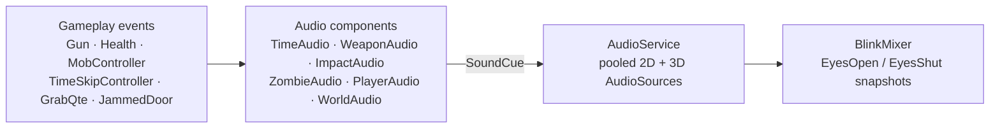

# BLINK: Audio

How the game makes sound, how to add a sound, and which event plays what. Sound picks and mixing guidance come from [FEEL_KIT.md](FEEL_KIT.md); credits are in [CREDITS.md](../CREDITS.md).

## How it fits together



- **Gameplay code never touches AudioSources or clips.** It raises C# events. Small components in `Scripts/Audio/` (namespace `Blink.Audio`) subscribe and play `SoundCue`s.
- Jack's `Noise` bus is **only for zombie hearing**. Audio doesn't go through it.
- **`SoundCue`** (`Assets/Art/Audio/Cues/*.asset`, Create > BLINK > Sound Cue): clips, clip order (random, no immediate repeat, or round-robin), volume and pitch ranges, 2D/3D blend, min/max distance (logarithmic rolloff), mixer group, priority and a cooldown in real seconds. An empty cue is silent, so it's a safe placeholder.
- **`AudioService`** (on GameSystems, `AudioService.Instance`): 8 2D and 16 3D pooled voices. When the pool is full it steals the oldest one-shot.
  - `Play(cue)`: 2D, in your head.
  - `PlayAt(cue, position)`: 3D, at a point.
  - `PlayAttached(cue, transform)`: 3D, follows the transform.
  - `PlayLoop(cue, transform = null)`: a loop. Returns an `AudioHandle` for `Stop(handle, fade)` and `SetVolume`. Stale handles are harmless.
- **Zombie vocals** use one AudioSource per zombie (a `Voice` child created at runtime), so a new vocal cuts off the last one and death silences the rest. Zombie footsteps go through the pool.

## Mixer: `Assets/Art/Audio/BlinkMixer.mixer`

```
Master
├─ Player   ├─ Gun   (pistol, reload, dry fire; axe later)
│           └─ Body  (footsteps, hurt, heartbeat)
├─ World    ├─ Impacts  (flesh, kill crunch, wall hits)
│           ├─ Zombies  (vocals, footsteps)
│           └─ Ambience (free for ambience beds)
│           (door creak and burst route to World itself)
├─ Stingers (blink shutter click, grab jump-scare)
└─ UI
```

- **Snapshots:**
  - `EyesOpen` (start): World Lowpass Simple at 22 kHz, World at 0 dB.
  - `EyesShut`: World low-passed to **800 Hz** and turned down **−4 dB**. Player and Stingers stay clear, so the heartbeat cuts through.
- **`TimeAudio`** switches snapshots:
  - `FastForwardStarted`: fade to `EyesShut` over 0.15 s.
  - `FastForwardEnded`: back to `EyesOpen` over 0.25 s. A grab (interrupted fast-forward) snaps back instantly.
- **Update Mode is Unscaled Time**, so the fades don't run 3× faster with your eyes shut.
- **Nothing is pitched with `Time.timeScale`.** Fast-forward is heard as muffle plus *more* zombie footsteps and groans (their timers use scaled time), not as chipmunks.
- **Rebuilding the mixer:** it was generated once through Unity's internal mixer editor API. To tweak it, just open it in Window > Audio > Audio Mixer.

## Time rules

| What | Clock | Why |
|---|---|---|
| Cue cooldowns, fades, heartbeat, player footsteps, pain cooldown | real (unscaled) | The player and UI stay out of world time |
| Zombie footsteps, zombie groan timer | world (scaled) | 3× as often with eyes shut: you hear them coming |
| Reload foley | follows `Gun.ReloadProgress01` | A blink jumps the foley with the reload (only the latest crossed point plays) |

## Event → sound map

| Event | Component (prefab) | Cue | 2D/3D | Group |
|---|---|---|---|---|
| `TimeSkipController.Skipped` | TimeAudio (GameSystems) | `Skip_Hit`: camera-shutter click (3 variants, random no-repeat, ±3% pitch, volume 0.5–0.58). `Skip_Boom` layer is empty (silent) | 2D | Stingers |
| `FastForwardStarted` | TimeAudio | `EyesShut` snapshot + `Player_BreathIn` | | |
| `FastForwardEnded(false)` | TimeAudio | `EyesOpen` snapshot + `Player_BreathOut` | | |
| `FastForwardEnded(true)` (grab) | TimeAudio | `EyesOpen` instantly + `Grab_Sting` | 2D | Stingers |
| `GrabQte.Began` | TimeAudio | `Grab_Sting` (1 s cooldown, so it doesn't double up with the interrupt) | 2D | Stingers |
| `GrabQte.Resolved(true)` | TimeAudio | `Player_GrabEscaped` (pant) | 2D | Body |
| `Gun.Fired` | WeaponAudio (Effects) | `Pistol_Shot` (3 variants with the room tail baked in, random no-repeat, ±3.5% pitch). `Pistol_Tail` is empty (silent), so there's no double tail | 2D | Gun |
| `Gun.DryFired` | WeaponAudio | `Pistol_DryFire` | 2D | Gun |
| `Gun.ReloadStarted` + `ReloadProgress01` | WeaponAudio | `Pistol_MagOut` (0.18 / 0.2), `Pistol_MagIn` (0.55), `Pistol_Slide` (0.82, empty reload only) | 2D | Gun |
| `Gun.Fired`, hit an `IDamageable` | ImpactAudio (Effects) | `Flesh_Hit` at the hit point | 3D | Impacts |
| … and that shot killed it | ImpactAudio | + `Flesh_Kill` | 3D | Impacts |
| `Gun.Fired`, hit a wall/prop | ImpactAudio | `Surface_Hit` | 3D | Impacts |
| `MobController.StateChanged` calm → Chase/Attack | ZombieAudio (Zombie) | `Zombie_Alert` | 3D voice | Zombies |
| `StateChanged` → Investigate | ZombieAudio | `Zombie_Search` | 3D voice | Zombies |
| Groan timer (5–12 world s, not while attacking) | ZombieAudio | `Zombie_Groan` | 3D voice | Zombies |
| `MobController.Attacked` | ZombieAudio | `Zombie_Attack` | 3D voice | Zombies |
| `Health.Damaged` (zombie) | ZombieAudio | `Zombie_Pain`: 50% chance, 0.8 s cooldown per zombie, not on the killing shot | 3D voice | Zombies |
| `Health.Died` (zombie) | ZombieAudio | `Zombie_Death`; stops other vocals for good | 3D voice | Zombies |
| Every 0.8 m the agent walks | ZombieAudio | `Zombie_Step` at the feet | 3D | Zombies |
| Every 1.6 m the player walks (grounded) | PlayerAudio (GameSystems) | `Player_Step` | 2D | Body |
| `Health.Damaged` (player) | PlayerAudio | none for now (`Player_HitThud` + `Player_Hurt` exist but are unassigned) | 2D | Body |
| `Health.Died` (player) | PlayerAudio | `Player_Death` | 2D | Body |
| `Gun.ReloadStarted` | WeaponAudio | `Pistol_ReloadStart` (cloth rustle) | 2D | Gun |
| Scene start | MusicAudio ×2 (GameSystems) | `Music_Bed` + `Ambience_Wind` (60 s seamless wind loop, vol 0.35) | 2D | Ambience |
| Nearest living zombie within 15 m | PlayerAudio | `Heartbeat` lub-dub retriggered at 65 → 170 bpm, volume 0.25 → 1 (×0.35 with eyes open; full while `BlinkDetector.EyesShut`). Each beat also raises `PlayerAudio.Heartbeat(intensity, bpm)`, which `GamepadHaptics` follows during fast-forward, so the rumble beats with the sound | 2D | Body |
| `JammedDoor.ForcingStarted` / `ForcingStopped` | WorldAudio (GameSystems) | `Door_ForcingLoop` loop at the door, 0.2 s fade out | 3D | World |
| `JammedDoor.Opened` | WorldAudio | `Door_Burst` | 3D | World |

**Unwired cues, ready for later:** `Axe_Swing` and `Axe_Hit`. Play them from `PlayerWeapons.MeleeSwing` / `MeleeHit` (see [ARCHITECTURE.md](ARCHITECTURE.md)).

## Adding or replacing a sound

1. Put the file in `Assets/Art/Audio/<Category>/`, named `Thing_Variant_01.wav`.
2. **Import settings:**
   - Short SFX: Decompress On Load, ADPCM. Gunshots and the shutter clicks use PCM.
   - **Normalize off** for clips that were loudness-matched as a set (gunshots, shutter clicks). With Force To Mono on, Unity's Normalize re-peaks each clip on its own and undoes the matching.
   - Loops: Compressed In Memory, Vorbis.
   - Force To Mono, unless it must be stereo.
3. Open the cue in `Assets/Art/Audio/Cues/` and add the clip to **Clips** (or replace one). That's it: every listener already uses the cue.
4. New kind of sound? Create a cue (Create > BLINK > Sound Cue) and pick its mixer group. In the component that listens to the right event, add a `[SerializeField] SoundCue` and call `AudioService.Instance.Play/PlayAt(cue)`.
5. Add a row to [CREDITS.md](../CREDITS.md) (required for CC-BY / OGA-BY). Only CC0, CC-BY and OGA-BY: no NC, SA or editorial licences.

## Gunshot and shutter sources

- **Pistol** (`Weapons/Pistol/Pistol_Shot_01..03`): the three near-distance takes of the **Walther PPQ 9 mm** in the Free Firearm Sound Library (`X_39P.wav`, left channel: one mic position for all three).
- **How they were processed** (Python/numpy, scripts not in the repo):
  - repaired the flat-topped (clipped) peaks with a cubic fit
  - resampled 96 → 48 kHz
  - high-passed at 35 Hz and added a low shelf (+4 dB at 180 Hz)
  - trimmed to 0.5 ms before the transient
  - faded out the outdoor reflections after 120–180 ms
  - applied light tanh saturation
  - added a nudge of up to ±0.6 dB at 2 kHz so each take matches the brightness of the set
  - baked in one shared **synthetic indoor room tail** (early reflections plus a band-wise decaying noise tail, RT60 about 1.2 s low / 0.8 s mid / 0.45 s high). The library is all outdoor recordings with almost no tail of their own.
  - matched loudness (RMS over the first 100 ms and peak within 0.6 dB) with the peak at about −1 dBFS
  - length 1.3 s, mono
- **Shutter** (`Stingers/Skip_Shutter_01..03`): three actuations of an **Olympus E-1 DSLR** from a burst recording (Internet Archive, CC0). Each is the mirror slap plus the curtain snap 26–30 ms later, 87 ms long. The low end was lifted slightly for body (+4 dB at 800 Hz, +3 dB shelf at 300 Hz), the peak is at −3 dBFS, and the cue volume is 0.5–0.58, so it sits well under the gun.

## Still to download (Freesound needs a login)

Better versions of what's in the game now, from the Feel Kit. All CC0 unless noted. Download, trim, and drop into the cue shown.

| Sound | Link | Into cue | Replaces |
|---|---|---|---|
| 9mm pistol shot | https://freesound.org/s/427592/ (michorvath) | `Pistol_Shot` | Free Firearm Library PPQ near takes + synthetic room tail |
| Small pistol, indoor tail | https://freesound.org/s/402789/ (acidsnowflake) | `Pistol_Shot` (as the whole shot), or a real tail in `Pistol_Tail` if the shots are re-cut dry | synthetic room tail baked into the shots |
| Dry pistol alt | https://freesound.org/s/344142/ (Brokenphono) | `Pistol_Shot` | |
| M9 reload | https://freesound.org/s/616758/ (One Shot) | split into `Pistol_MagOut` / `Pistol_MagIn` / `Pistol_Slide` | zer0_sol reload slices |
| Dry fire | https://freesound.org/s/119168/ (davdud101) | `Pistol_DryFire` | Baradari click |
| Bullet into flesh | https://freesound.org/s/528263/ (magnuswaker), https://freesound.org/s/138481/ (JustInvoke) | `Flesh_Hit` | Will Leamon fleshy hits |
| Gore squelch layer | https://freesound.org/s/513315/ | `Flesh_Kill` | |
| Bullet ricochets | https://freesound.org/s/148840/, https://freesound.org/s/30932/ | `Surface_Hit` | Kenney wood/generic pitched up |
| Hurt grunts | https://freesound.org/s/547209/ (MrFossy series) | `Player_Hurt` | Jack Menhorn (vocalised) |
| Grab jump-scare | https://freesound.org/s/366168/ (Unaxete) | `Grab_Sting` | Packsmithy jump scare + braam |
| Blink skip shutter | https://freesound.org/s/116609/ (mrmccormack, old Nikon, CC0), https://freesound.org/s/396091/ (joshuaempyre, Canon T70, CC BY 4.0), https://freesound.org/s/42899/ (FreqMan, Canon D30, CC BY 4.0) | `Skip_Hit` | Olympus E-1 shutter (archive.org) |
| Heartbeat (single lub-dub) | https://freesound.org/s/551437/ (ZHRØ) | `Heartbeat` (one beat only: it's retriggered) | bart heartbeat |
| Eyes-open gasp | https://freesound.org/s/389996/ | assign a new cue to TimeAudio `eyesOpenCue` | (none) |
| Door straining / rattle | https://freesound.org/s/218163/, https://freesound.org/s/256606/ | `Door_ForcingLoop` (make a seamless loop) | fractilegames cabinet creak |
| Door burst | https://freesound.org/s/160213/ (qubodup), https://freesound.org/s/669457/ | `Door_Burst` | Kenney heavy wood impacts |
| Zombie moans | https://freesound.org/people/PaulMorek/packs/12519/ | `Zombie_Groan` | |
| Zombie aggro growl | https://freesound.org/s/133974/ | `Zombie_Alert` | LRSF monster screams |
| Zombie bites | https://freesound.org/s/155973/, https://freesound.org/s/518155/ | `Zombie_Attack` | |
| Zombie death | https://freesound.org/s/534602/ | `Zombie_Death` | Baradari deaths |
| Zombie shuffling steps | https://freesound.org/s/189231/ (Starvolt) | `Zombie_Step` | GboxMikeFozzy steps |
| Catastic Zombie Sound Pack Free | https://assetstore.unity.com/packages/audio/sound-fx/zombie-sound-pack-free-version-124430 | any zombie cue | (Asset Store login) |

Not built yet: blood drips, generator, interior creaks.
