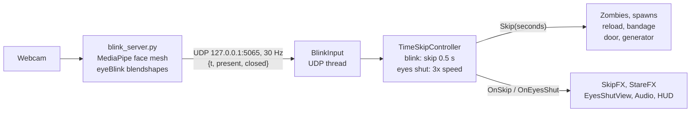

# BLINK: Game Plan

**Every time you blink, time skips forward. Use it, but only when it's safe.**

BLINK is a first-person, single-player zombie escape game for the CSS Game Jam (University of Bristol), theme **TIME**. A webcam watches your eyes. Each blink jumps the world forward. Keep your eyes shut and time fast-forwards: your reload finishes, the door gives way, the generator charges, and the zombies keep coming.

We're building for the jam demo under ideal conditions: our laptop, our webcam, good lighting, and one of us setting the judge up. Polish what the judge sees in the first five minutes; don't spend time hardening for other setups.

- **Engine:** Unity 6 (URP), C#, plus a small Python webcam sidecar.
- **Jam format (based on last year; confirm this year's details):** Saturday 10:00 to Sunday 16:00, MVB 2.11, about 30 hours of build time. Judges play each game live for a few minutes.
- **Prizes we're targeting:** Best Overall (£500), Most Innovative Use of Time (£300), Best Graphics (£400), People's Choice (£400).
- **Why it works:** judges blink without thinking, so the "oh!" moment arrives on its own. It isn't SUPERHOT: the world runs in real time, and closing your eyes is a tool you have to decide when to use.

---

## Core loop: skips are a resource

Time skipping helps and hurts in the same moment. Everything in the world moves forward, including the things working for you.

**Fight → clear some space → close your eyes → progress → open → fight.**

### What skipping speeds up

| Works for you | Works against you |
|---|---|
| Reload finishes (~2 s) | Zombies close the distance |
| Bandage heals you (~4 s) | New zombies spawn in |
| Door is forced open (~8 s of effort) | The horde reaches the door you're forcing |
| Generator charges to power the exit (~30 s) | |

### Two ways to skip

| Input | Effect | When it happens |
|---|---|---|
| **Blink** | Instant jump forward of ~0.5 s | Involuntary. You can't avoid them, so you're always giving a little ground. |
| **Eyes held shut** | World runs at ~3× for as long as you keep them closed | Deliberate. This is how you get things done fast. |

### The balance
- Objectives are tuned so they take **too long with eyes open**. The generator alone would take 30 s of real time with zombies arriving every few seconds. With eyes shut it takes about 10 s. You have to close your eyes to escape.
- The question every few seconds is **"Is it safe to close my eyes right now?"** Clear the nearby zombies, check the distance, then commit.
- **If a zombie reaches you while your eyes are shut**, it grabs you: you take damage, the screen slams back to full view, and a jump-scare sound hits. Greed is punished, but not with instant death.
- **Reading danger without looking:** while your eyes are shut, a heartbeat and zombie footsteps get louder and faster as they approach, and on a gamepad you feel it: a low rumble the whole time your eyes are shut, with a lub-dub on every heartbeat that gets faster and harder as they close in. A good player learns to open their eyes on the sound and the pulse alone.
- **Looking away does nothing.** If the webcam can't see your face, your eyes count as open. Only closing your eyes moves time.

### What the screen shows while eyes are shut
The player can't see it, but the judges and the crowd can. Show the fast-forward in a dark, desaturated "behind the eyelids" view with zombies as red silhouettes rushing in. The audience watches the danger the player can only hear, which is great for People's Choice.

---

## Other mechanics

| Mechanic | What happens |
|---|---|
| Gun and flashlight | Instant-hit pistol with limited ammo and reload. The flashlight is the main light source in the fog. |
| Zombies | Chase you constantly using Unity's navmesh. Slow individually, dangerous in numbers. |
| Stare cost | After ~8 s without blinking, vision blurs, red veins creep in and the view shakes slightly. Cosmetic pressure to blink. |
| Skip FX | On every reopen: hard cut, sound hit, chromatic aberration flash, and ghost trails from each zombie's old position to its new one. |
| Changes while you're not looking | During skips, doors swing shut, bodies vanish, props move. Cheap horror beats. First thing to cut. |

**Title screen:** "Blink to begin." **End screen:** "You escaped in N blinks."

---

## Level

One linear escape, about 5 minutes for a judge. Each area teaches one more use of skipping.

1. **Safe room (first 30 s):** a single slow zombie shambles in, so the first natural blink lands fast. The way out is a jammed door: hold your eyes shut to force it. *Teaches: blinking moves time; closing your eyes gets things done.*
2. **Ward / corridor:** ammo is tight, zombies come in small groups, and there's a bandage station. *Teaches: clear the area, then skip to reload or heal.*
3. **Exit:** the generator has to charge to power the exit gate while the horde pours in. Fight, clear, close your eyes, open, fight again. *The climax of the balancing act.*

Setting is still open (hospital, subway or mall). Pick whatever we can dress fastest.

---

## Look and sound

- **Visuals:** darkness, fog, the flashlight beam as the key light. URP post-processing: colour grading, film grain, vignette, bloom, chromatic aberration on skips. Ghost trails after each skip are the hero screenshot.
- **Assets:** zombie models and animations from Mixamo (free), environment from an asset pack, lifted by lighting.
- **Audio:** near silence with eyes open: breathing, distant groans. A sharp hit on every skip. The eyes-shut fast-forward is pure sound design: heartbeat, shuffling and footsteps that get closer. This is where the scares live.

---

## Architecture

- **Python sidecar** (`blink_server/blink_server.py`): MediaPipe Face Landmarker, one face, `closed` from the average of the `eyeBlinkLeft`/`eyeBlinkRight` blendshapes with hysteresis (close above 0.5, reopen below 0.35). Use **Python 3.12**: MediaPipe likely doesn't support 3.14 yet.
- **`BlinkInput`:** UDP listener thread. Detects blink edges and how long the eyes have been closed. No keyboard fallback (`Space` is Jump); without a webcam, `blink_server/send_test_blinks.py` fakes the packets. A missing face counts as eyes open.
- **`TimeSkipController`:** a blink calls `Skip(0.5)` on everything that implements `ISkippable`. Eyes held shut sets `Time.timeScale` to about 3 and switches to the eyes-shut view. Camera, UI and audio cues use unscaled time.
- **`ISkippable.Skip(seconds)`:** no physics stepping. Zombies move along their navmesh path by speed × seconds and are placed with `NavMeshAgent.Warp`. Timers (reload, bandage, door, generator, spawns) just add the seconds.
- **Other scripts:** `PlayerController`, `Gun`, `Zombie`, `Objective` (door and generator), `SkipFX`, `StareFX`, `EyesShutView`, `AudioDirector`, `GameFlow`.
- **For the demo build:** Unity starts the sidecar with `Process.Start` (bundled with PyInstaller), so the judge never sees a terminal.

---

## Timeline (~30 h)

| Hours | Goal | Done when |
|---|---|---|
| **0–3** | Blink sidecar, cube test | A cube in Unity jumps forward on a real blink and on a fake one from `send_test_blinks.py`. In parallel: FPS controller and level blockout. |
| **3–8** | Core loop playable | Walk, shoot, zombies chase, death and restart all work. Blink skips and eyes-shut fast-forward work with the webcam and `send_test_blinks.py`. |
| **8–13** | Skips for good | Reload, bandage, door and generator all advance during skips. Grab-while-eyes-shut works. Skip FX in. Tuned with the real webcam. |
| **13–19** | Art, lighting, audio | The level looks and sounds like the final game, including the eyes-shut view and its audio. |
| **19–23** | Balance and menus | Objective timings tuned so eyes-shut is required. Stare FX, title and end screens in. |
| **23–27** | Playtests | Strangers have played it. Tune skip length, fast-forward speed, zombie speed and the first 30 s. **Feature lock at H27.** |
| **27–30** | Build and demo prep | Build tested on the demo laptop, itch page up, GIFs recorded, demo rehearsed. |

**Cut list, in order:** things changing while you're not looking → bandage → stare FX. Never cut the skip FX or the eyes-shut view: they sell the game.

---

## Demo day

- Our laptop and webcam, good lighting, judge seated about 1 m from the camera at eye height.
- One-line onboarding: **"Every time you blink, time skips. Close your eyes to get things done, if you dare."**
- Unity launches the sidecar itself; no terminal on screen.
- Keep `blink_server/send_test_blinks.py` ready as a backup (there is no keyboard blink).
- Show the blink count on the end screen and invite them to beat it.

## Before the jam

- [ ] Check the jam rules on code written before the jam. If allowed, prototype the blink sidecar early.
- [ ] Move the repo out of OneDrive (for example `C:\dev\`) to avoid locked files in Unity's `Library/`.
- [ ] Install Python 3.12 and test MediaPipe blink detection on the demo laptop and webcam.
- [ ] Pick the setting and shortlist asset packs (environment, Mixamo zombies, sound effects).
- [ ] Everyone clones the repo and opens the Unity project once.
- [ ] Assign owners: blink tech, gameplay, level and art, audio and UI.
